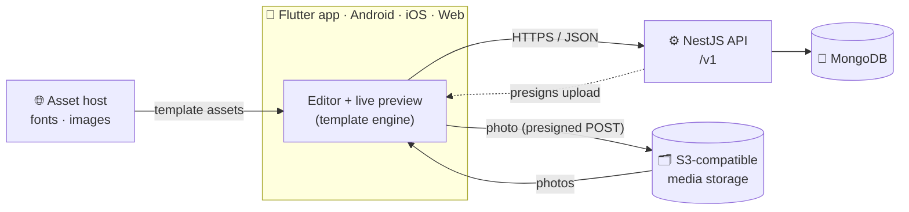

<p align="center">
  
</p>

<h1 align="center">Invitara</h1>

<p align="center">
  <strong>Every celebration begins with an invitation.</strong><br />
  <em>Create · Personalize · Celebrate</em>
</p>

<p align="center">
  
  
  
  
  
  <br />
  
  
  
</p>

<p align="center">
  <a href="#-overview">Overview</a> ·
  <a href="#-features">Features</a> ·
  <a href="#-architecture">Architecture</a> ·
  <a href="#-getting-started">Getting started</a> ·
  <a href="#-api-reference">API</a> ·
  <a href="#-testing--quality">Testing</a> ·
  <a href="#-documentation">Docs</a>
</p>

---

## ✨ Overview

**Invitara** is a cross-platform digital invitation platform. People enter their event details, choose a design, personalize it with a live preview, and export the finished invitation. One shared **Flutter** codebase runs on **Android, iOS and Web**, backed by a **NestJS** API.

Designs are **data, not code**. Every invitation design is a versioned JSON specification interpreted by the app's own template engine, so new designs ship without new screens. The same renderer draws the editor preview and the exported image, so what you see is exactly what you get.

## 🚦 Project status

| Milestone | Status |
|---|:---:|
| Sprint 0: Foundations | ✅ Completed |
| Sprint 1: Authentication | ✅ Completed |
| Sprint 2: Template engine | ✅ Completed |
| Sprint 3: Invitation creation and editing | ✅ Completed |
| Sprint 4: Publishing and sharing | 🗓️ Planned |
| Production cloud infrastructure | ⏳ Not provisioned |

> [!NOTE]
> Everything currently runs **locally**. AWS, MongoDB Atlas and Sentry have not been provisioned yet. [`docs/progress.md`](docs/progress.md) records every sprint: what was built, how it was verified, and what is deferred or blocked.

## 🎉 Features

<table>
  <tr>
    <td width="33%" valign="top">
      <h3>🎨 Versioned templates</h3>
      JSON specs with text, image and shape layers, custom fonts and bindings like <code>{{event.personName}}</code>. Validated in CI, immutable once published.
    </td>
    <td width="33%" valign="top">
      <h3>⚡ Live preview</h3>
      The invitation re-renders on every keystroke. Designs are previewed with <em>your</em> details before you pick one.
    </td>
    <td width="33%" valign="top">
      <h3>📥 High-res export</h3>
      Client-side PNG at the template's full canvas (1080 × 1920). The server never renders.
    </td>
  </tr>
  <tr>
    <td width="33%" valign="top">
      <h3>🔐 Secure accounts</h3>
      Registration, login, rotating refresh tokens (httpOnly cookie on web, Keychain/Keystore on mobile), password change, and account deletion that removes all data.
    </td>
    <td width="33%" valign="top">
      <h3>🔄 Conflict-aware saving</h3>
      On-device draft autosave and debounced version-checked saves. A stale edit gets <code>409</code> instead of silently overwriting newer work.
    </td>
    <td width="33%" valign="top">
      <h3>📸 Photo uploads</h3>
      Photos go straight to S3-compatible storage with presigned POST policies issued by the API. Bytes never pass through the server.
    </td>
  </tr>
</table>

## 🧰 Technology stack

| Area | Technology |
|---|---|
| **App** | Flutter 3.44.7, Dart 3.12 |
| **State management** | Riverpod 3 |
| **Navigation** | GoRouter |
| **Networking** | Dio |
| **Models & serialization** | Freezed, json_serializable |
| **Local storage** | Hive CE (drafts and cache), flutter_secure_storage (tokens) |
| **API** | NestJS 11, TypeScript, Node.js 22 |
| **Database** | MongoDB 7, Mongoose 8 |
| **Authentication** | JWT (HS256) and opaque rotating refresh tokens |
| **Validation & security** | class-validator, Helmet, Throttler |
| **Media** | S3-compatible storage (AWS SDK v3); AWS S3 + CloudFront planned for production |
| **Local infrastructure** | Docker Compose, nginx, SeaweedFS |
| **CI** | GitHub Actions |

Planned production infrastructure: ECS Fargate behind an Application Load Balancer, MongoDB Atlas, S3, CloudFront, Route 53, Secrets Manager and Sentry. **It is not operational yet.**

## 🏗️ Architecture



Locally, the asset host is **nginx** (`:8081`) and media storage is **SeaweedFS** (`:9000`). In the planned production setup both sit behind **CloudFront**.

### Key design decisions

- **One renderer.** The Flutter template engine renders both the live preview and the exported PNG, so the preview always matches the output.
- **Immutable template versions.** A published template key and version never changes in place. Updates require a new version, and invitations pin an exact one.
- **Optimistic concurrency.** Invitation writes carry the current `version`. A stale update gets `409`, and the client shows the latest copy.
- **Direct media upload.** The API authorizes the upload and issues a presigned POST; the app sends the photo straight to storage.
- **Tenant-aware data model.** Every document carries `tenantId`, and it comes first in every database index.

All 13 architecture decisions (D1–D13) are in [`docs/01-architecture.md`](docs/01-architecture.md).

## 📁 Repository structure

```text
invite_generator/
├── app/                     # 📱 Flutter app (Android, iOS, Web)
│   ├── lib/
│   │   ├── app/             #    Router, theme and design tokens
│   │   ├── core/            #    Config, networking and storage
│   │   ├── features/        #    Auth, profile, templates, invitations, media
│   │   ├── shared/          #    Shared widgets and validators
│   │   └── template_engine/ #    Specs, binder, renderer and exporter
│   ├── test/                #    Unit, widget and golden tests
│   └── config/              #    Dev, staging and production defines
├── api/                     # ⚙️ NestJS backend
│   ├── src/modules/         #    Domain modules (unit tests sit beside the code)
│   ├── src/common/          #    Guards, decorators and error handling
│   ├── test/                #    End-to-end tests
│   └── scripts/             #    Template validation
├── templates/               # 🎨 Versioned template JSON, fonts and samples
├── docker/                  # 🐳 Local infrastructure configuration
├── docs/                    # 📚 Architecture and delivery documentation
└── .github/workflows/       # 🤖 API and app CI workflows
```

## 🚀 Getting started

### Prerequisites

- 🐳 **Docker Desktop**
- 🟩 **Node.js 22** (`.nvmrc` is provided, so `nvm use` works)
- 💙 **Flutter 3.44.7** / Dart 3.12
- 🤖 Android Studio for Android · 🍎 Xcode for iOS · 🌐 Chrome for Web

### ⚡ Quick start

```bash
docker compose up -d mongo assets s3                                    # local services
(cd api && cp .env.example .env && npm ci && npm run build && npm run db:seed-templates && npm run start:dev)
```

```bash
cd app && flutter pub get
flutter run -d chrome --web-port 8080 --dart-define-from-file=config/dev.json
```

The steps below explain each part.

### 1. Start local services

From the repository root:

```bash
docker compose up -d mongo assets s3
```

| Service | Host port | Purpose |
|---|---:|---|
| 🍃 MongoDB | `27018` | Local application database |
| 🖼️ nginx assets | `8081` | Template fonts and images, served with CORS (stands in for the CDN) |
| 🗂️ SeaweedFS | `9000` | S3-compatible local media storage (stands in for the media bucket) |

> [!TIP]
> The Compose MongoDB uses port **27018**, so it never clashes with a personal MongoDB on `27017`, and tests can never touch your own data.

### 2. Configure and run the API

```bash
cd api
cp .env.example .env
npm ci
npm run build
npm run db:seed-templates   # validates templates/, inserts each version once
npm run start:dev
```

The API runs at `http://localhost:3000`. Check its health endpoint:

```bash
curl http://localhost:3000/health   # {"status":"ok"}
```

> [!IMPORTANT]
> Run the API **on the host machine** when you use the app. Presigned upload URLs contain the API's `S3_ENDPOINT` (`http://localhost:9000`), which must be reachable from the app or simulator.

### 3. Run the Flutter app

```bash
cd app
flutter pub get
```

<details>
<summary><b>🌐 Web</b></summary>

```bash
flutter run -d chrome --web-port 8080 --dart-define-from-file=config/dev.json
```

Port `8080` is the default allowed origin in `WEB_APP_ORIGIN`.
</details>

<details>
<summary><b>🍎 iOS simulator</b></summary>

```bash
flutter run -d "iPhone 17 Pro" --dart-define-from-file=config/dev.json
```

The simulator shares the host's network; no extra setup.
</details>

<details>
<summary><b>🤖 Android emulator</b></summary>

Forward the local service ports after starting the emulator:

```bash
adb reverse tcp:3000 tcp:3000
adb reverse tcp:8081 tcp:8081
adb reverse tcp:9000 tcp:9000
```

Then run:

```bash
flutter run --dart-define-from-file=config/dev.json
```

Repeat the `adb reverse` commands after every emulator restart.
</details>

### 4. Try the app

1. Create an account.
2. Choose **New invitation → Birthday** and enter the event details. They're autosaved on the device.
3. Pick a design. Each one is previewed with your details.
4. Edit with the live preview and add a photo. Changes save automatically.

Non-production builds also include **Browse designs** and a **Template playground** in the home screen menu.

### 5. Stop local services

```bash
docker compose down      # keeps local volumes
docker compose down -v   # also removes the volumes and their data
```

## ⚙️ Configuration

<details>
<summary><b>API environment variables</b> (documented in <a href="api/.env.example"><code>api/.env.example</code></a>, validated at startup)</summary>

| Variable | Purpose |
|---|---|
| `NODE_ENV` | Runtime environment (`development`, `test`, `staging` or `production`) |
| `PORT` | API port; defaults to `3000` |
| `MONGODB_URI` | MongoDB connection string **(required)** |
| `JWT_ACCESS_SECRET` | HS256 signing secret, at least 32 characters **(required)** |
| `WEB_APP_ORIGIN` | Allowed Web origin; defaults to `http://localhost:8080` |
| `TRUST_PROXY_HOPS` | Number of trusted proxy hops (1 behind the ALB) |
| `ASSET_BASE_URL` | Base URL for template assets |
| `S3_BUCKET` / `S3_REGION` | Media bucket and region |
| `S3_ENDPOINT` | Local S3-compatible endpoint; unset when using AWS |
| `MEDIA_BASE_URL` | Public media URL prefix |
| `AWS_ACCESS_KEY_ID` / `AWS_SECRET_ACCESS_KEY` | Local stand-in credentials only |

The API refuses to start if a value is missing or malformed.
</details>

<details>
<summary><b>Flutter flavors</b> (<code>app/config/*.json</code>, passed with <code>--dart-define-from-file</code>)</summary>

| Key | Purpose |
|---|---|
| `FLAVOR` | `dev`, `staging` or `prod`; dev-only tools are hidden in `prod` |
| `API_BASE_URL` | API origin; `/v1` is added by the client |
| `ASSET_BASE_URL` | Template asset and sample-photo origin |
| `SENTRY_DSN` | Optional crash-reporting DSN |

The staging and production host values are **placeholders** until infrastructure is provisioned.
</details>

> [!WARNING]
> Never commit `.env` files or production secrets (they're git-ignored). In AWS, the planned ECS task role supplies storage credentials.

## 📡 API reference

Base URL: `http://localhost:3000/v1`. Endpoints marked 🌐 are public; everything else needs `Authorization: Bearer <accessToken>`.

| Method | Path | Purpose |
|---|---|---|
| `GET` | `/health` 🌐 | Liveness check (outside `/v1`) |
| `POST` | `/auth/register` 🌐 | Register an account |
| `POST` | `/auth/login` 🌐 | Sign in |
| `POST` | `/auth/refresh` 🌐 | Rotate the refresh token (body, or cookie on web) |
| `POST` | `/auth/logout` 🌐 | End the session |
| `GET` · `PATCH` | `/users/me` | Read or update the profile |
| `POST` | `/users/me/password` | Change password (signs out other devices) |
| `DELETE` | `/users/me` | Delete the account and all associated data |
| `GET` | `/templates` | List renderable templates (event type, cursor pagination) |
| `GET` | `/templates/:id` | Retrieve a specific template version |
| `POST` | `/invitations` | Create a draft |
| `GET` | `/invitations` | List your own invitations |
| `GET` · `PUT` · `DELETE` | `/invitations/:id` | Read, update (needs `version`) or soft-delete |
| `POST` | `/media/upload-url` | Create a presigned photo upload (JPEG, PNG, WebP; 10 MB) |

Every error uses one envelope, `{ error: { code, message, details[] }, requestId }`. Full contracts and examples are in [`docs/02-data-and-api.md`](docs/02-data-and-api.md).

## 🎨 Working with templates

Each design lives at `templates/<key>/template.json` and follows [`templates/schema.v1.json`](templates/schema.v1.json). Asset paths are relative to `templates/`; the API makes them absolute using `ASSET_BASE_URL` when seeding.

```bash
cd api && npm run templates:validate                    # schema + semantic checks
cd app && flutter test --tags golden --update-goldens   # then review the PNGs in test/template_engine/goldens/
cd api && npm run db:seed-templates                     # inserts new versions; re-runs are a no-op
```

> [!CAUTION]
> Never modify a published version. Increment its `version` when its content changes; the seed refuses changed content under an existing version.

Fonts are distributed under the SIL Open Font License; the licence files sit alongside them.

## 🧪 Testing & quality

<details open>
<summary><b>⚙️ API</b> (run from <code>api/</code>; needs the local MongoDB and S3 stand-in)</summary>

```bash
npx eslint "{src,test}/**/*.ts"
npm run build
npm test                 # unit
npm run test:e2e         # end-to-end, against the compose MongoDB and S3 stand-in
npm run test:scripts     # template validator
npm run templates:validate
npm audit --omit=dev --audit-level=high
```
</details>

<details open>
<summary><b>📱 Flutter</b> (run from <code>app/</code>)</summary>

```bash
dart format --output=none --set-exit-if-changed lib test
flutter analyze
flutter test --exclude-tags golden
flutter test --tags golden   # macOS only: golden images are platform-sensitive
```

After changing a Freezed or json_serializable model, regenerate the committed files:

```bash
dart run build_runner build --delete-conflicting-outputs
```
</details>

## 🤖 Continuous integration

| Workflow | Runs |
|---|---|
| [`api.yml`](.github/workflows/api.yml) | Lint, build, unit and script tests, template validation, end-to-end tests (MongoDB + SeaweedFS), production dependency audit, Docker image build |
| [`app.yml`](.github/workflows/app.yml) | Format, analyze, non-golden tests, Web build, Android release APK; on macOS: golden tests and an iOS simulator build |

## ☁️ Deployment status

Production deployment is **not operational yet**. The target is ECS Fargate behind an ALB, MongoDB Atlas, S3 and CloudFront, with Route 53, Secrets Manager and GitHub Actions OIDC for deployment. Provisioning is blocked on an AWS account, an Atlas organization, a domain and a Sentry organization.

Before production, the CDN must:
- serve template assets and user photos with Web CORS support and immutable caching;
- never serve `template.json` files.

Production indexes are created as a deployment step (`npm run db:indexes`), not on application boot.

The deployment plan is in [`docs/04-delivery-and-operations.md`](docs/04-delivery-and-operations.md); current blockers are in [`docs/progress.md`](docs/progress.md).

## 🛠️ Troubleshooting

| Symptom | What to check |
|---|---|
| Web requests fail with CORS errors | Run Web on port `8080`, or update `WEB_APP_ORIGIN`. |
| Android cannot reach the API | Re-run all three `adb reverse` commands after an emulator restart. |
| Photo upload fails | Run the API on the host with `S3_ENDPOINT=http://localhost:9000`; check `docker compose ps s3`. |
| Template seed rejects changed content | Bump the template's `version`. |
| `LocaleDataException` | Initialize date formatting for locales other than `en_US`. |
| Golden tests fail on Linux or Windows | Run golden tests on macOS. |
| End-to-end tests use the wrong database | They use `mongodb://localhost:27018/invite_test`, never port `27017`. |

More implementation notes are in [`.claude/skills/invite-platform/SKILL.md`](.claude/skills/invite-platform/SKILL.md).

## 📚 Documentation

| | Document | What's inside |
|:---:|---|---|
| 🏛️ | [Architecture](docs/01-architecture.md) | Decisions D1–D13, system structure, authentication, error handling |
| 🗃️ | [Data & API](docs/02-data-and-api.md) | MongoDB schemas, indexes, API contracts, sequence diagrams |
| 🎨 | [Template engine](docs/03-template-engine.md) | JSON template spec, binding, rendering, export |
| 🚚 | [Delivery & operations](docs/04-delivery-and-operations.md) | Roadmap, deployment, security, operations |
| 📈 | [Progress](docs/progress.md) | Sprint-by-sprint implementation, verification, deferred work, blockers |

## 🧭 Engineering workflow

Work is delivered incrementally:

**read** the relevant design document → **implement** the smallest complete change → **verify** with the commands above → **record** the result in `docs/progress.md`.

The repository's [`invite-platform`](.claude/skills/invite-platform/SKILL.md) skill holds the detailed workflow and engineering conventions.

---

<p align="center">
  <br /><br />
  <strong>Invitara</strong><br />
  <em>Create · Personalize · Celebrate</em>
</p>
