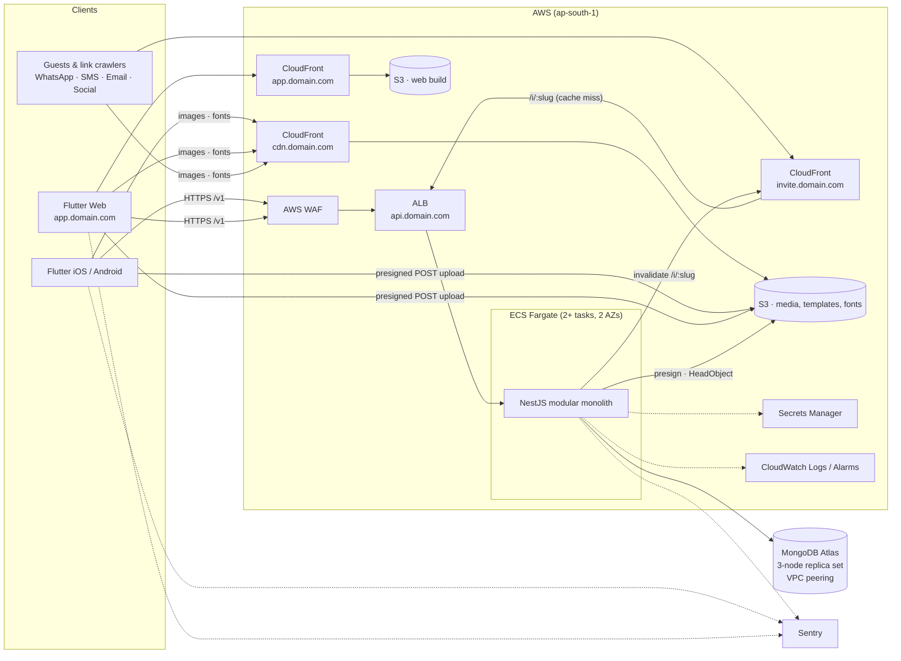
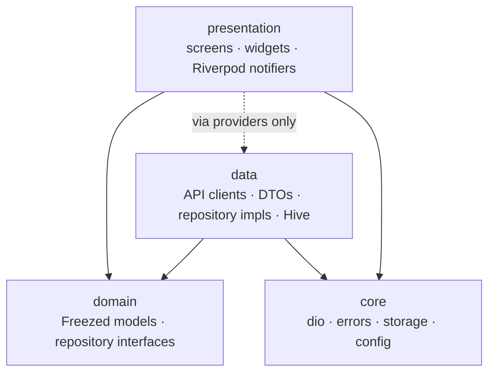
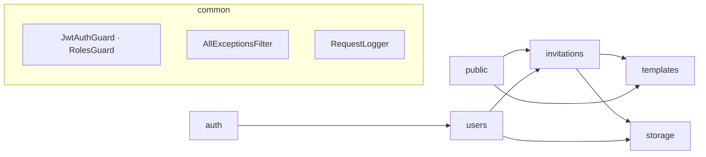

# 01 — System Architecture

Event Invitation Platform · Android · iOS · Web
Related: [02 Data & API](02-data-and-api.md) · [03 Template Engine](03-template-engine.md) · [04 Delivery & Operations](04-delivery-and-operations.md)

---

## 1. Architecture decisions (read this first)

Each decision lists the trigger that would make us revisit it. Anything not listed here is deliberately out of scope for Phase 1.

| # | Decision | Why | Revisit when |
|---|----------|-----|--------------|
| D1 | **Modular monolith** (one NestJS deployable, one module per domain) | Team of ~5, 100k users is small load. Modules have hard boundaries so they can be extracted later. | A module needs its own scaling profile or team (e.g. analytics ingestion, rendering jobs). |
| D2 | **Public invite page (`/i/{slug}`) is server-rendered HTML** from the API, cached at CloudFront, **not Flutter Web** | WhatsApp/iMessage/Facebook crawlers don't run JS, so no OG preview from a Flutter page. Flutter Web cold load is 2–3 MB in an in-app browser; the HTML page is ~15 KB + one image. | Guests need rich interactivity beyond RSVP (then: a small JS island, still not Flutter). |
| D3 | **One renderer: Flutter.** The client renders the invitation image at publish time and uploads it; the server never renders templates | Two renderers (Flutter + server) always drift. Preview = published output by construction. | We need to re-render already-published invitations in bulk (template bug fix) → add a headless Flutter render job. |
| D4 | **Templates are immutable, versioned JSON documents.** Invitations pin a specific template document | Editing a template must never silently change a published invitation. Immutable = cacheable forever. | — |
| D5 | **MongoDB Atlas** (managed replica set), no sharding | 500k invitations × ~8 KB ≈ 4 GB. A single replica set handles that for years. | Data > ~200 GB or sustained write-bound (likely only `rsvps`/`analytics`). |
| D6 | **No Redis in Phase 1** | Public reads are CloudFront-cached, templates are immutable (in-process cache), and AWS WAF does rate limiting across tasks. | RSVP counters, job queues, cross-task throttling, or sessions needing sub-ms lookups. |
| D7 | **JWT access token (15 min) + opaque rotating refresh token** stored hashed in `sessions` | Revocable sessions, reuse detection, per-device logout. | — |
| D8 | **Repositories throw typed `AppFailure`; no `Either`** | Riverpod's `AsyncValue` already models success/error. `Either` adds a dependency and boilerplate on every call. | — |
| D9 | **No use-case layer in Flutter** | Use cases that only forward one repository call are boilerplate. Providers call repository *interfaces* (still mockable). | Logic spans multiple repositories → add a use case for that flow only. |
| D10 | **Multi-tenant ready:** `tenantId` on every document, first in every index, single tenant `default` today | Retrofitting tenancy into data is the expensive part. Adding it now costs one field. | First white-label/B2B customer → resolve tenant from host/JWT. |
| D11 | **Event types:** a class-transformer discriminator on the backend, a Freezed sealed union in Flutter | Type-safe. Adding a type = 1 DTO + 1 union variant + 1 form section + templates. | Event types change more often than app releases → server-driven forms. |
| D12 | **Event date/time stored as wall-clock** (`date`, `time`, IANA `timezone`) | An invite shows the venue's local time. No tz math or tz package needed for Phase 1. | Reminders/notifications → add computed `startsAtUtc`. |
| D13 | **Minimum OS: Android 8.0 (API 26), iOS 15** (decided 2026-11-06) | `sentry_flutter` 10 requires both; Flutter's defaults (24 / 13.0) fail to build. These floors cover the large majority of active devices. | A required plugin raises its floor again, or analytics show meaningful demand below these versions. |

---

## 2. System architecture



### Hostnames

| Host | Serves | Origin | Caching |
|------|--------|--------|---------|
| `app.domain.com` | Flutter Web app (creators) | S3 (OAC) | `no-cache` + ETag (Flutter web filenames are not hashed) |
| `api.domain.com` | REST API `/v1/*` | ALB → ECS | none |
| `invite.domain.com` | Public pages `/i/{slug}` | ALB → ECS | `s-maxage=300`, invalidated on change |
| `cdn.domain.com` | Templates, fonts, user media, rendered invites | S3 (OAC) | `max-age=31536000, immutable` (content-addressed keys) |

---

## 3. Repository layout (monorepo)

The current Flutter project moves into `app/`.

```
invite-platform/
├── app/                    # Flutter (iOS, Android, Web)
├── api/                    # NestJS
├── templates/              # Template JSON + source assets, reviewed in PRs, seeded to S3/Mongo
│   └── birthday-balloons/
│       ├── template.json
│       └── assets/ (bg.webp, confetti.webp, …)
├── infra/                  # Terraform (envs/staging, envs/prod, modules/*)
├── docs/
└── .github/workflows/      # api.yml, app.yml, web.yml, infra.yml
```

---

## 4. Flutter architecture

### 4.1 Folder structure

```
app/lib/
├── main.dart                         # bootstrap: Sentry, Hive, ProviderScope
├── app/
│   ├── app.dart                      # MaterialApp.router
│   ├── router.dart                   # GoRouter + auth redirect
│   └── theme/
│       ├── app_theme.dart            # light/dark ThemeData (Material 3)
│       └── tokens.dart               # AppTokens ThemeExtension (spacing, radii)
├── core/
│   ├── config/env.dart               # --dart-define-from-file values (API_BASE_URL, …)
│   ├── network/
│   │   ├── dio_provider.dart
│   │   ├── auth_interceptor.dart     # attach token, single-flight refresh
│   │   └── failure_mapper.dart       # DioException → AppFailure
│   ├── error/app_failure.dart
│   ├── storage/
│   │   ├── token_store.dart          # flutter_secure_storage (mobile) / memory+cookie (web)
│   │   └── local_cache.dart          # Hive boxes
│   └── pagination/page.dart          # Page<T>{items, nextCursor}
├── shared/widgets/                   # AsyncValueView, AppTextField, PrimaryButton, …
├── template_engine/                  # feature-agnostic; see 03-template-engine.md
│   ├── model/                        # TemplateSpec, Layer (sealed), Frame, TextStyleSpec
│   ├── binding/binder.dart           # {{path|formatter}} resolution
│   ├── render/                       # InvitationCanvas, layer views, FontRegistry
│   └── export/exporter.dart          # PNG, JPEG (upload), PDF
└── features/
    ├── auth/
    │   ├── data/      auth_api.dart · auth_repository_impl.dart · dto/
    │   ├── domain/    user.dart · auth_repository.dart
    │   └── presentation/ auth_controller.dart · login_screen.dart · register_screen.dart
    ├── profile/
    │   ├── data/ · domain/ · presentation/ profile_screen.dart
    ├── templates/
    │   ├── data/      templates_api.dart · templates_repository_impl.dart
    │   ├── domain/    template_summary.dart · templates_repository.dart
    │   └── presentation/ template_picker_screen.dart · templates_providers.dart
    ├── invitations/
    │   ├── data/      invitations_api.dart · invitations_repository_impl.dart · dto/
    │   ├── domain/    invitation.dart · event_details.dart · event_data.dart · invitations_repository.dart
    │   └── presentation/
    │       ├── list/       invitations_list_screen.dart · invitations_list_controller.dart
    │       ├── create/     event_type_screen.dart · details_screen.dart · forms/birthday_fields.dart
    │       ├── editor/     invitation_editor_controller.dart · preview_screen.dart
    │       └── share/      publish_controller.dart · share_screen.dart
    └── media/
        └── data/      media_api.dart · uploader.dart   # presigned POST
```

`template_engine/` stays inside `lib/` for now. **Extract it to `packages/template_engine`** when a second consumer appears, such as the designer web editor or a headless render job.

### 4.2 Layering rules



- `domain` imports nothing from Flutter except `meta`/Freezed. It has no Dio and no Hive.
- `presentation` gets repositories through providers that are typed as the **interface**. Tests override the provider with a fake.
- Features don't import each other's `data/`. Shared needs go through `domain` or `core`.
- **Models vs DTOs:** domain models are Freezed classes with `fromJson`, because we own the API and the shapes match. *Request* DTOs exist per write call (`CreateInvitationRequest`). A separate response DTO is added only when the API shape diverges from the domain model.

### 4.3 State management (Riverpod, no codegen)

| Provider | Type | Lifetime | Purpose |
|----------|------|----------|---------|
| `envProvider` | `Provider<Env>` | app | Config |
| `dioProvider` | `Provider<Dio>` | app | Configured client with interceptors |
| `tokenStoreProvider` | `Provider<TokenStore>` | app | Secure token persistence |
| `authRepositoryProvider` | `Provider<AuthRepository>` | app | Interface-typed |
| `authControllerProvider` | `AsyncNotifierProvider<AuthController, AuthState>` | app | `Authenticated(user)` / `Unauthenticated`; drives router redirect |
| `templatesProvider(eventType)` | `FutureProvider.family` | autoDispose | Catalog; Hive stale-while-revalidate |
| `templateSpecProvider(id)` | `FutureProvider.family` | **keepAlive** | Full spec; immutable, so cached for the session |
| `invitationsListControllerProvider` | `AsyncNotifierProvider` | autoDispose | Cursor pagination, filter by status |
| `invitationEditorProvider(id)` | `AsyncNotifierProvider.family` | autoDispose | Loads invitation, holds local edits, debounced `PUT` (800 ms) with `version` |
| `previewDataProvider(id)` | `Provider.family` | derived | `BindingContext` from editor state → live preview |
| `publishControllerProvider(id)` | `AsyncNotifierProvider.family` | autoDispose | render → encode → upload → publish |

**Live preview** is free. The renderer is a pure function of `(TemplateSpec, BindingContext)`, so the preview screen watches `previewDataProvider(id)` and rebuilds on every keystroke. Saving is debounced separately.

Wizard state needs no global store. The details form is local (Hive-autosaved) until submit. Submit `POST`s a draft, puts `/` underneath and pushes `/invitations/:id/template` (so back always leads to My invitations), and from then on the invitation id is the state key. The picker opened from the editor carries `?change=1` and pops back; after creation it replaces itself with the editor. Screens reached directly (link, web refresh) show a home button instead of back. Drafts therefore resume across devices.

### 4.4 Navigation (GoRouter)

| Path | Screen | Auth |
|------|--------|------|
| `/login`, `/register` | Auth | public only |
| `/` | My invitations (list, filters) | ✓ |
| `/invitations/new` | Select event type | ✓ |
| `/invitations/new/:eventType` | Enter event details (POST draft on submit) | ✓ |
| `/invitations/:id/template` | Select template | ✓ |
| `/invitations/:id/preview` | Live preview + edit panel → Publish | ✓ |
| `/invitations/:id/share` | Public link, share targets, PNG/PDF export | ✓ |
| `/invitations/:id` | Manage (edit, unpublish, delete, export) | ✓ |
| `/profile` | Profile, password, logout, delete account | ✓ |
| `/dev/template-playground` | Render local template JSON (debug builds only) | ✓ |

```dart
final routerProvider = Provider<GoRouter>((ref) {
  final authState = ValueNotifier<AuthState?>(null);
  ref.listen(authControllerProvider, (_, next) => authState.value = next.asData?.value,
      fireImmediately: true);
  ref.onDispose(authState.dispose);

  return GoRouter(
    refreshListenable: authState,
    redirect: (context, state) {
      final auth = authState.value;
      if (auth == null) return null; // still restoring session
      final onAuthPage = state.matchedLocation == '/login' || state.matchedLocation == '/register';
      return switch (auth) {
        Unauthenticated() when !onAuthPage => '/login?from=${Uri.encodeComponent(state.uri.toString())}',
        Authenticated() when onAuthPage => state.uri.queryParameters['from'] ?? '/',
        _ => null,
      };
    },
    routes: [/* table above */],
  );
});
```

On web, the URL is the source of truth, so deep links and refresh work on every route because each screen loads by `:id`. This needs `GoRouter.optionURLReflectsImperativeAPIs = true` (set in `main.dart`); without it, `push` leaves the address bar on the previous route.

### 4.5 Domain models (Freezed 3)

```dart
enum InvitationStatus { draft, published, unpublished }

@freezed
abstract class Invitation with _$Invitation {
  const factory Invitation({
    required String id,
    required InvitationStatus status,
    required EventDetails details,
    required EventData eventData,
    String? templateId,
    @Default(InvitationMedia()) InvitationMedia media,
    String? slug,
    String? publicUrl,
    String? pageImageUrl,
    required int version,          // optimistic concurrency
    required DateTime updatedAt,
  }) = _Invitation;
  factory Invitation.fromJson(Map<String, dynamic> json) => _$InvitationFromJson(json);
}

@freezed
abstract class EventDetails with _$EventDetails {
  const factory EventDetails({
    required String eventName,
    required String hostName,
    required Venue venue,
    required String date,          // 'yyyy-MM-dd' (venue wall-clock)
    required String time,          // 'HH:mm'
    required String timezone,      // IANA, e.g. 'Asia/Kolkata'
    String? description,
    String? contactPhone,          // E.164
    @Default(Rsvp()) Rsvp rsvp,
  }) = _EventDetails;
  factory EventDetails.fromJson(Map<String, dynamic> json) => _$EventDetailsFromJson(json);
}

/// Discriminated by `type` inside the object — single source of truth for the event type.
@Freezed(unionKey: 'type')
sealed class EventData with _$EventData {
  const factory EventData.birthday({required String personName, int? age}) = BirthdayData;
  // Phase 2:
  // const factory EventData.wedding({required String brideName, required String groomName}) = WeddingData;
  // const factory EventData.babyShower({required String motherName, String? fatherName}) = BabyShowerData;
  factory EventData.fromJson(Map<String, dynamic> json) => _$EventDataFromJson(json);
}
```

Request DTO example:

```dart
@freezed
abstract class CreateInvitationRequest with _$CreateInvitationRequest {
  const factory CreateInvitationRequest({
    required EventDetails details,
    required EventData eventData,
    String? templateId,
  }) = _CreateInvitationRequest;
  factory CreateInvitationRequest.fromJson(Map<String, dynamic> json) =>
      _$CreateInvitationRequestFromJson(json);
}
```

### 4.6 API layer (Dio)

- One `Dio` with `baseUrl = env.apiBaseUrl + '/v1'`, timeouts of 10s connect and 20s receive, and the header `X-Client-Renderer: <rendererVersion>`.
- Interceptors, in order: `AuthInterceptor` → Sentry breadcrumb → (debug) log.
- Thin typed API classes per feature (`InvitationsApi`), which handle JSON ↔ models only. Repositories wrap them and map errors.
- **Web:** `BrowserHttpClientAdapter(withCredentials: true)`, so the refresh token travels as an `httpOnly` cookie and is never visible to JS.

```dart
/// Serialises 401 handling so concurrent requests trigger ONE refresh.
class AuthInterceptor extends QueuedInterceptor {
  AuthInterceptor(this._tokens, this._bareDio, this._onSessionExpired);
  final TokenStore _tokens;
  final Dio _bareDio;               // same baseUrl, no AuthInterceptor
  final void Function() _onSessionExpired;

  @override
  Future<void> onRequest(RequestOptions o, RequestInterceptorHandler h) async {
    final token = await _tokens.accessToken();
    if (token != null) o.headers['Authorization'] = 'Bearer $token';
    h.next(o);
  }

  @override
  Future<void> onError(DioException e, ErrorInterceptorHandler h) async {
    final req = e.requestOptions;
    if (e.response?.statusCode != 401 || req.extra['retried'] == true) return h.next(e);

    // Another queued request may already have refreshed while this one waited.
    final current = await _tokens.accessToken();
    final sentWith = (req.headers['Authorization'] as String?)?.substring(7);
    final refreshed = current != null && current != sentWith ? true : await _refresh();
    if (!refreshed) {
      _onSessionExpired();
      return h.next(e);
    }
    req
      ..extra['retried'] = true
      ..headers['Authorization'] = 'Bearer ${await _tokens.accessToken()}';
    try {
      h.resolve(await _bareDio.fetch(req));
    } on DioException catch (err) {
      h.next(err);
    }
  }

  Future<bool> _refresh() async {
    try {
      final refreshToken = await _tokens.refreshToken(); // null on web (cookie)
      final res = await _bareDio.post('/auth/refresh',
          data: refreshToken == null ? null : {'refreshToken': refreshToken});
      await _tokens.save(AuthTokens.fromJson(res.data as Map<String, dynamic>));
      return true;
    } on DioException {
      await _tokens.clear();
      return false;
    }
  }
}
```

### 4.7 Error handling

```dart
sealed class AppFailure implements Exception {
  const AppFailure(this.message);
  final String message;                       // safe to show to users
}
final class NetworkFailure extends AppFailure { const NetworkFailure() : super('No internet connection. Try again.'); }
final class UnauthenticatedFailure extends AppFailure { const UnauthenticatedFailure() : super('Please sign in again.'); }
final class ValidationFailure extends AppFailure {
  const ValidationFailure(super.message, this.fieldErrors);
  final Map<String, String> fieldErrors;      // 'details.venue.name' → message
}
final class NotFoundFailure extends AppFailure { const NotFoundFailure() : super('This item no longer exists.'); }
final class ConflictFailure extends AppFailure { const ConflictFailure(super.message); } // stale version, email taken
final class RateLimitedFailure extends AppFailure { const RateLimitedFailure() : super('Too many attempts. Wait a minute.'); }
final class ServerFailure extends AppFailure {
  const ServerFailure(this.requestId) : super('Something went wrong on our side.');
  final String? requestId;
}
```

- `failure_mapper.dart` maps a `DioException` plus the [API error envelope](02-data-and-api.md#21-conventions) to one `AppFailure`. Repositories call it in a single `try/catch` helper, so no screen ever sees a `DioException`.
- UI uses `AsyncValueView(value, data: …)` for loading, error (with retry), and data. `ValidationFailure.fieldErrors` are pushed into form fields.
- On `ConflictFailure` from the editor's stale `version`, the editor reloads the server copy and shows "Updated on another device".
- `FlutterError.onError` and `PlatformDispatcher.instance.onError` go to Sentry, with `requestId` attached when present.

### 4.8 Local storage

| Store | What | Why |
|-------|------|-----|
| `flutter_secure_storage` (iOS Keychain / Android Keystore) | access + refresh tokens | Tokens never go in Hive. |
| Web | access token **in memory**; refresh token in an `httpOnly; Secure; SameSite=Lax` cookie set by the API | localStorage is readable by any XSS. |
| Hive (`hive_ce`, the maintained Hive fork, same API) box `cache` | template catalog JSON, template specs (immutable), last invitation list page | Instant start, offline browse. Values are JSON strings, so no type adapters or generator are needed. |
| Hive box `drafts` | unsent "new invitation" form (autosave every change) | Survives app kill before the first `POST`. |

### 4.9 Theme system

- Material 3 `ColorScheme.fromSeed` for light and dark. Brand values live in one `AppTokens extends ThemeExtension<AppTokens>` (spacing scale, radii, elevation), read via `context.tokens`.
- Typography from `TextTheme`. App UI follows the user's text scale. **The invitation canvas does not** (see [03 §5](03-template-engine.md#5-renderer)), because export must equal preview.
- Minimum tap target is 48 dp, contrast is checked for both schemes, and every icon button has a `Semantics`/`tooltip`.

### 4.10 Dependencies

```yaml
dependencies:
  flutter_riverpod: ^3.0.0
  go_router: ^16.0.0
  dio: ^5.8.0
  freezed_annotation: ^3.0.0
  json_annotation: ^4.9.0
  hive_ce: ^2.11.0
  hive_ce_flutter: ^2.3.0
  flutter_secure_storage: ^9.2.0
  intl: ^0.20.0
  image: ^4.5.0           # JPEG encode for uploads
  pdf: ^3.11.0            # PDF export
  share_plus: ^11.0.0     # native share sheet / Web Share API
  url_launcher: ^6.3.0    # wa.me, sms:, mailto:
  sentry_flutter: ^9.0.0
dev_dependencies:
  build_runner: ^2.5.0
  freezed: ^3.0.0
  json_serializable: ^6.9.0
  flutter_lints: ^6.0.0
```

Pin exact versions in `pubspec.lock` at Sprint 0. The versions above are floors, so check pub.dev for the current majors.

---

## 5. NestJS architecture

### 5.1 Folder structure

```
api/
├── src/
│   ├── main.ts                       # helmet, cookie-parser, CORS, ValidationPipe, prefix, shutdown hooks
│   ├── app.module.ts
│   ├── config/env.ts                 # class-validator schema for process.env — fail fast at boot
│   ├── common/
│   │   ├── auth/                     # @Public, @Roles, @CurrentUser, JwtAuthGuard (global), RolesGuard (global)
│   │   ├── errors/                   # ErrorCode enum, AllExceptionsFilter
│   │   ├── http/                     # request-logger.middleware.ts, cursor.ts
│   │   └── tenancy/tenant.ts         # DEFAULT_TENANT, tenant resolution
│   └── modules/
│       ├── auth/                     # register, login, refresh, logout (controller + service only)
│       ├── sessions/                 # sessions schema + SessionsService (rotate, revoke); used by auth AND users, no cycle
│       ├── users/                    # user schema, password.ts (scrypt); /users/me (get, patch, delete), password change
│       ├── templates/                # list, get; immutable docs; in-process cache
│       ├── invitations/              # CRUD, publish, unpublish; slug.ts; dto/event-data.dto.ts
│       ├── public/                   # GET /v1/public/invitations/:slug (JSON), GET /i/:slug (HTML)
│       ├── storage/                  # S3 presigned POST, HeadObject, CloudFront invalidation
│       ├── app-config/               # GET /v1/app-config (min supported app version)
│       └── health/                   # GET /health (ALB)
├── scripts/
│   ├── seed-templates.ts             # templates/*/template.json → S3 assets + Mongo docs
│   └── migrations/                   # idempotent index/data migrations, run in CI before deploy
├── test/                             # e2e (supertest + Mongo service container)
└── Dockerfile
```

### 5.2 Module map



Modules export **services only**, never Mongoose models. `public` reads through `InvitationsService.findPublishedBySlug()`, so ownership and status rules live in one place. `users.delete` cascades through `InvitationsService` and `StorageService`.

### 5.3 Request pipeline

```
ALB → helmet → RequestLogger (requestId = X-Amzn-Trace-Id | uuid)
    → ThrottlerGuard (auth routes) → JwtAuthGuard (global; @Public opts out) → RolesGuard
    → ValidationPipe {whitelist, forbidNonWhitelisted, transform}
    → Controller → Service → Mongoose (sanitizeFilter: true)
    → AllExceptionsFilter (uniform envelope)
```

```ts
// main.ts (essentials)
const app = await NestFactory.create(AppModule, {
  logger: new ConsoleLogger({ json: env.NODE_ENV !== 'development' }), // Nest 11 built-in JSON logs
});
app.use(helmet(), cookieParser());
app.enableCors({ origin: env.WEB_APP_ORIGIN, credentials: true });
app.setGlobalPrefix('v1', { exclude: ['i/:slug', 'health'] });
app.useGlobalPipes(new ValidationPipe({ whitelist: true, forbidNonWhitelisted: true, transform: true }));
app.enableShutdownHooks(); // drain on SIGTERM during ECS deploys
mongoose.set('sanitizeFilter', true); // strips $-operators from user-supplied filter values
```

### 5.4 Authentication & authorization

**Tokens**
- Access: JWT HS256, 15 min, claims `{ sub, tid, roles, sid }`. The secret comes from Secrets Manager. Move to RS256 + JWKS only if another service must verify tokens.
- Refresh: opaque `"{sessionId}.{32 random bytes base64url}"`, 30 days. Only `sha256(secret)` is stored, and it is rotated on every refresh. **Reuse detection:** if a presented secret doesn't match the session's current hash, the token was replayed, so the whole session is revoked.
- Mobile receives the refresh token in the response body. Web receives it as an `httpOnly; Secure; SameSite=Lax; Path=/v1/auth` cookie. `/auth/refresh` accepts either.

**Passwords:** `node:crypto` scrypt (N=2¹⁴, r=8, p=5, 64-byte key, 16-byte salt) is an OWASP-listed parameter set. It uses about 16 MB per hash, which matters on a 1 GB Fargate task under login bursts, and needs no native dependency. The format is `scrypt$N$r$p$salt$hash` so parameters can be raised later.

```ts
// password.ts
export async function hashPassword(pw: string): Promise<string> {
  const salt = randomBytes(16);
  const key = await scryptAsync(pw, salt, 64, { N: 16384, r: 8, p: 5 });
  return ['scrypt', 16384, 8, 5, salt.toString('base64'), key.toString('base64')].join('$');
}
export async function verifyPassword(pw: string, stored: string): Promise<boolean> {
  const [, N, r, p, salt, hash] = stored.split('$');
  const expected = Buffer.from(hash, 'base64');
  const key = await scryptAsync(pw, Buffer.from(salt, 'base64'), expected.length, { N: +N, r: +r, p: +p });
  return timingSafeEqual(key, expected);
}
const scryptAsync = (pw: string, salt: Buffer, len: number, opts: ScryptOptions) =>
  new Promise<Buffer>((ok, fail) => scrypt(pw, salt, len, opts, (e, k) => (e ? fail(e) : ok(k))));
```

**Global guard: secure by default**

```ts
@Injectable()
export class JwtAuthGuard implements CanActivate {
  constructor(private readonly jwt: JwtService, private readonly reflector: Reflector) {}

  async canActivate(ctx: ExecutionContext): Promise<boolean> {
    if (this.reflector.getAllAndOverride<boolean>(IS_PUBLIC, [ctx.getHandler(), ctx.getClass()])) return true;
    const req = ctx.switchToHttp().getRequest<Request & { user?: AccessClaims }>();
    const [scheme, token] = req.headers.authorization?.split(' ') ?? [];
    if (scheme !== 'Bearer' || !token) throw new UnauthorizedException();
    try {
      req.user = await this.jwt.verifyAsync<AccessClaims>(token);
    } catch {
      throw new UnauthorizedException();
    }
    return true;
  }
}
// app.module.ts: providers: [{ provide: APP_GUARD, useClass: JwtAuthGuard }, { provide: APP_GUARD, useClass: RolesGuard }]
```

**Authorization**
- Roles are `user` (default), `admin`, and later `designer`, checked with `@Roles('admin')` + `RolesGuard`.
- **Ownership is enforced in the query, not after it.** Every invitation query includes `{ tenantId, ownerId: user.sub, deletedAt: null }`. Another user's id returns **404, not 403**, so ids can't be enumerated.

### 5.5 Validation (event-type polymorphism)

```ts
export class BirthdayDataDto {
  @Equals('birthday') type!: 'birthday';
  @IsString() @Length(1, 60) personName!: string;
  @IsOptional() @IsInt() @Min(0) @Max(130) age?: number;
}

export class CreateInvitationDto {
  @ValidateNested() @Type(() => EventDetailsDto) details!: EventDetailsDto;

  @ValidateNested()
  @Type(() => Object, {
    keepDiscriminatorProperty: true,
    discriminator: {
      property: 'type',
      subTypes: [{ name: 'birthday', value: BirthdayDataDto }], // Phase 2: add one line per event type
    },
  })
  eventData!: BirthdayDataDto; // union type grows in Phase 2

  @IsOptional() @IsMongoId() templateId?: string;
}

export class EventDetailsDto {
  @IsString() @Length(1, 80) eventName!: string;
  @IsString() @Length(1, 80) hostName!: string;
  @ValidateNested() @Type(() => VenueDto) venue!: VenueDto;
  @IsISO8601({ strict: true }) @Length(10, 10) date!: string; // yyyy-MM-dd
  @Matches(/^([01]\d|2[0-3]):[0-5]\d$/) time!: string;
  @IsTimeZone() timezone!: string;
  @IsOptional() @IsString() @MaxLength(1000) description?: string;
  @IsOptional() @IsPhoneNumber() contactPhone?: string;
  @IsOptional() @ValidateNested() @Type(() => RsvpDto) rsvp?: RsvpDto;
}
```

The DTO is the trust boundary. Mongoose stores `eventData` as a sub-document, and the DTO has already guaranteed its shape.

### 5.6 Error handling

`AllExceptionsFilter` maps everything to one envelope (see [02 §2.1](02-data-and-api.md#21-conventions)):

| Source | HTTP | `code` |
|--------|------|--------|
| `ValidationPipe` (`BadRequestException` with messages) | 400 | `VALIDATION_FAILED` + `details[{field, message}]` |
| `UnauthorizedException` | 401 | `UNAUTHENTICATED` |
| `ForbiddenException` | 403 | `FORBIDDEN` |
| `NotFoundException`, Mongoose `CastError` (bad ObjectId) | 404 | `NOT_FOUND` |
| Mongo `E11000` duplicate key, stale `version` | 409 | `CONFLICT` |
| `ThrottlerException` | 429 | `RATE_LIMITED` |
| anything else | 500 | `INTERNAL` (message hidden; stack logged; Sentry) |

### 5.7 Logging & observability

- Nest 11 `ConsoleLogger({ json: true })` writes to stdout, then CloudWatch Logs via the awslogs driver. **No logging library.**
- Request middleware logs one line per request: `requestId, method, route, status, durationMs, userId, tenantId`. It never logs bodies, tokens, passwords, or phone numbers.
- `requestId` comes from the ALB `X-Amzn-Trace-Id` header. It is returned in the `X-Request-Id` header and in error bodies.
- Sentry (`@sentry/nestjs`) captures 5xx only.

### 5.8 Dependencies

`@nestjs/{common,core,platform-express,config,mongoose,jwt,throttler}`, `mongoose`, `class-validator`, `class-transformer`, `helmet`, `cookie-parser`, `@aws-sdk/{client-s3,s3-presigned-post,client-cloudfront}`, `@sentry/nestjs`.
**Not used:** passport (one JWT guard is ~20 lines), bcrypt/argon2 (built-in scrypt), pino (built-in JSON logger), Redis.
