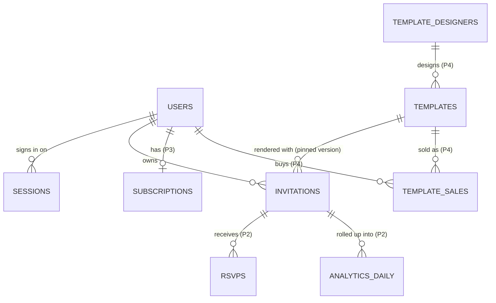
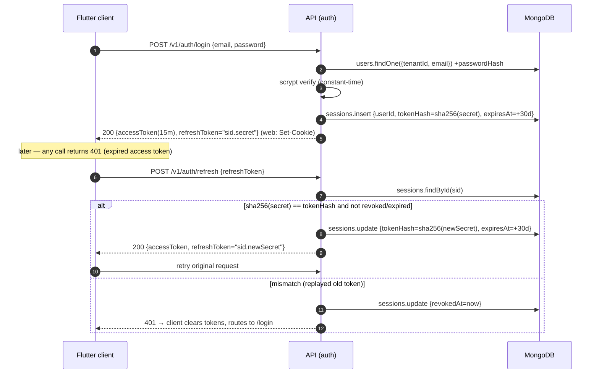
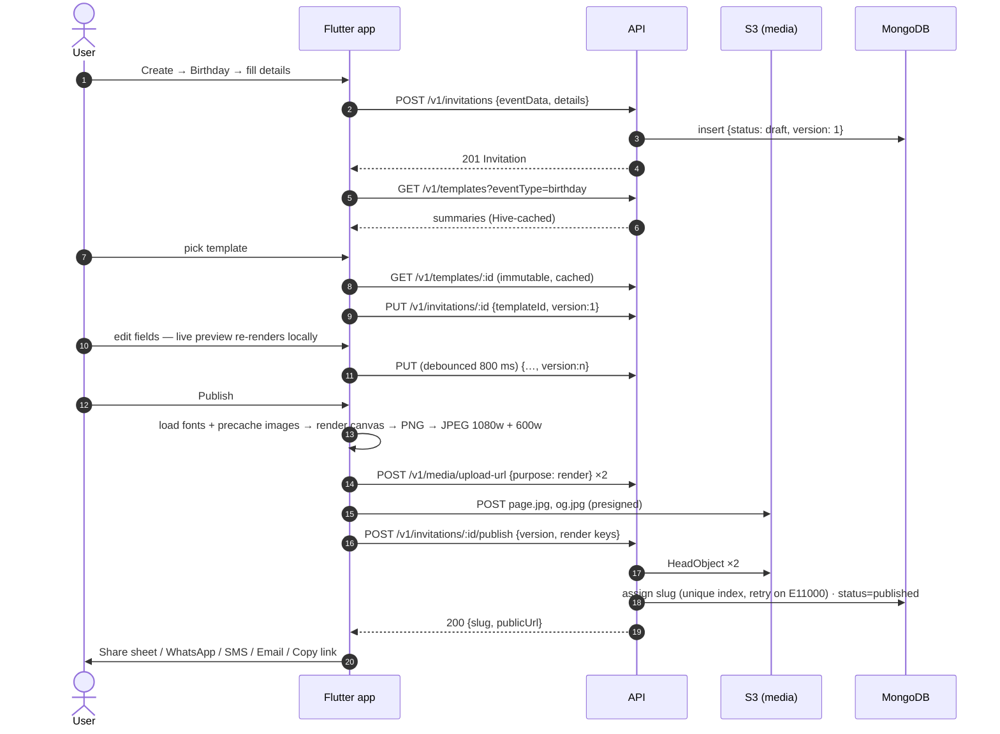
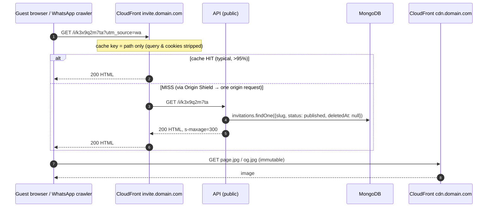
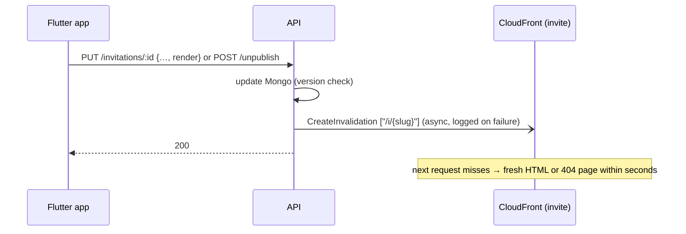
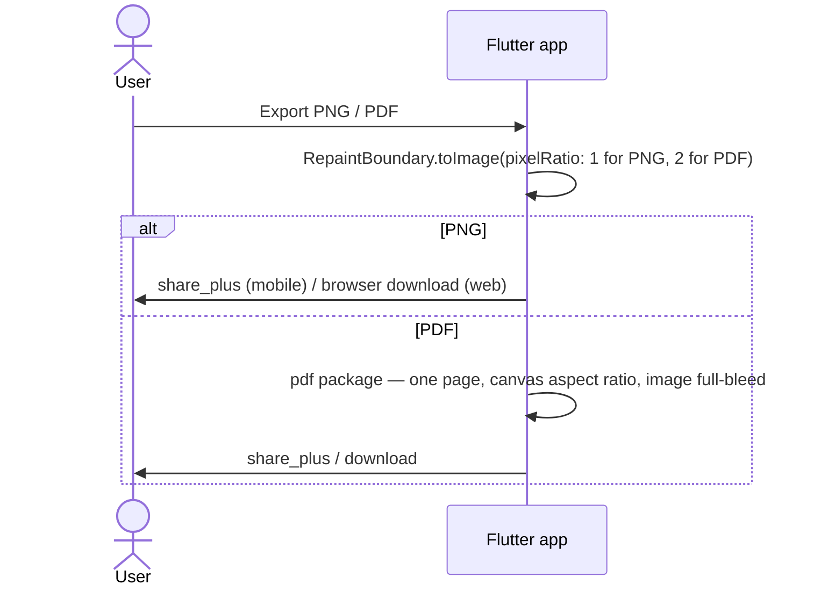

# 02 — Data Model, API Contracts, Sequences

Related: [01 Architecture](01-architecture.md) · [03 Template Engine](03-template-engine.md) · [04 Delivery & Operations](04-delivery-and-operations.md)

---

## 1. MongoDB

### 1.1 Collections

| Collection | Phase | Purpose | Est. size @100k users |
|------------|-------|---------|-----------------------|
| `users` | 1 | Accounts, profile, roles, plan | 100k × 1 KB = 100 MB |
| `sessions` | 1 | Refresh-token sessions (one per device), TTL-expired | ~200k × 0.5 KB |
| `templates` | 1 | Immutable, versioned template specs | < 10k × 20 KB |
| `invitations` | 1 | Drafts + published invitations | 500k × 8 KB = 4 GB |
| `rsvps` | 2 | Guest responses | grows with views; first sharding candidate |
| `analytics_daily` | 2 | Daily rollups per invitation (from CloudFront logs) | 1 doc/invitation/day with traffic |
| `subscriptions` | 3 | Plan state mirrored from RevenueCat/Stripe webhooks | ≤ users |
| `template_designers` | 4 | Designer profiles, KYC, payout status | small |
| `template_sales` | 4 | Purchase ledger (append-only), revenue share | grows with sales |

`sessions` is one more collection than the brief listed. Storing refresh tokens hashed and revocable needs it, and putting them on `users` would make every refresh rewrite the user doc.

### 1.2 Conventions

- Every document has `tenantId: string` (default `'default'`), `createdAt`, `updatedAt` (Mongoose `timestamps: true`), and `version: number` where concurrent edits matter.
- References are `ObjectId`s, and there are **no `$lookup` on hot paths**. The public page reads one invitation plus one template, and templates come from the in-process cache.
- **Soft delete** (`deletedAt`) for invitations. A TTL index purges them after 30 days.
- `autoIndex: false` in staging/prod. Indexes are created by `scripts/migrations` in CI, so a large index build never runs on app boot.
- Read preference is `primary` (the default). Writes use `w: 'majority'`.

### 1.3 Schemas

```ts
// users
@Schema({ timestamps: true, collection: 'users' })
export class User {
  @Prop({ required: true, default: 'default' }) tenantId: string;
  @Prop({ required: true, lowercase: true, trim: true }) email: string;
  @Prop({ required: true, select: false }) passwordHash: string;
  @Prop({ required: true, trim: true, maxlength: 80 }) name: string;
  @Prop() phone?: string;                                   // E.164
  @Prop() avatarUrl?: string;
  @Prop({ type: [String], default: ['user'] }) roles: ('user' | 'admin' | 'designer')[];
  @Prop({ default: 'free' }) plan: 'free' | 'premium';      // Phase 3: mirrored from subscriptions
  @Prop({ default: 'active' }) status: 'active' | 'disabled';
  @Prop() emailVerifiedAt?: Date;
  @Prop() lastLoginAt?: Date;
}
```

```ts
// sessions — one per signed-in device
@Schema({ timestamps: true, collection: 'sessions' })
export class Session {
  @Prop({ required: true }) tenantId: string;
  @Prop({ required: true, type: Types.ObjectId }) userId: Types.ObjectId;
  @Prop({ required: true }) tokenHash: string;              // sha256 of current refresh secret
  @Prop({ required: true }) expiresAt: Date;                // sliding: now + 30d on each refresh
  @Prop() revokedAt?: Date;
  @Prop() userAgent?: string;
  @Prop() ip?: string;
}
```

```ts
// templates — immutable once status = 'published'; edits create version + 1
@Schema({ timestamps: true, collection: 'templates' })
export class Template {
  @Prop({ required: true }) tenantId: string;
  @Prop({ required: true }) key: string;                    // 'birthday-balloons'
  @Prop({ required: true }) version: number;                // 1, 2, 3 …
  @Prop({ required: true }) status: 'draft' | 'published' | 'archived';
  @Prop({ required: true }) schemaVersion: number;          // template JSON schema version
  @Prop({ required: true }) minRendererVersion: number;     // clients below this never see it
  @Prop({ required: true }) name: string;
  @Prop() description?: string;
  @Prop({ type: [String], required: true }) eventTypes: string[];
  @Prop({ type: [String], default: [] }) tags: string[];
  @Prop({ default: false }) isPremium: boolean;
  @Prop({ type: Types.ObjectId }) designerId?: Types.ObjectId; // Phase 4
  @Prop({ default: 0 }) sortOrder: number;
  @Prop({ type: Object, required: true }) spec: TemplateSpec;  // canvas, fonts, background, layers — see 03
}
```

```ts
// invitations
@Schema({ timestamps: true, collection: 'invitations' })
export class Invitation {
  @Prop({ required: true }) tenantId: string;
  @Prop({ required: true, type: Types.ObjectId }) ownerId: Types.ObjectId;
  @Prop({ required: true, default: 'draft' }) status: 'draft' | 'published' | 'unpublished';
  @Prop({ type: Types.ObjectId }) templateId?: Types.ObjectId;     // pins an exact template version
  @Prop({ type: Object, required: true }) details: {
    eventName: string; hostName: string;
    venue: { name: string; address?: string; mapUrl?: string };
    date: string; time: string; timezone: string;                 // wall-clock, see D12
    description?: string; contactPhone?: string;
    rsvp: { enabled: boolean; deadline?: string; phone?: string; note?: string };
  };
  @Prop({ type: Object, required: true }) eventData: { type: string } & Record<string, unknown>;
  @Prop({ type: Object, default: {} }) media: { photoUrl?: string };
  @Prop() slug?: string;                                    // assigned on first publish, never changes
  @Prop() pageImageUrl?: string;                            // cdn …/page.jpg (1080w)
  @Prop() ogImageUrl?: string;                              // cdn …/og.jpg (600w)
  @Prop() publishedAt?: Date;
  @Prop() deletedAt?: Date;
  @Prop({ required: true, default: 1 }) version: number;
}
```

### 1.4 Indexes

| Collection | Index | Options | Serves |
|------------|-------|---------|--------|
| users | `{tenantId:1, email:1}` | unique | login, register uniqueness |
| sessions | `{expiresAt:1}` | TTL `expireAfterSeconds: 0` | auto-purge expired sessions |
| sessions | `{userId:1}` | | logout-all, account deletion |
| templates | `{tenantId:1, key:1, version:-1}` | unique | versioning, seed upsert |
| templates | `{tenantId:1, status:1, eventTypes:1, sortOrder:1}` | | catalog listing |
| invitations | `{tenantId:1, ownerId:1, deletedAt:1, updatedAt:-1, _id:-1}` | | "my invitations", cursor pagination |
| invitations | `{slug:1}` | unique, partial `{slug: {$type: 'string'}}` | public lookup, slug collision check |
| invitations | `{deletedAt:1}` | TTL `expireAfterSeconds: 2592000` | hard-delete soft-deleted docs after 30 days |
| rsvps *(P2)* | `{invitationId:1, createdAt:-1}` | | host RSVP list |

The slug index is global, not tenant-prefixed, because the public URL namespace is global.

### 1.5 Relationships



### 1.6 Scalability strategy

| Stage | Trigger | Action |
|-------|---------|--------|
| Launch | — | Atlas **M10**, 3-node replica set, same region as ECS, VPC peering, continuous backup |
| Growth | CPU > 60% sustained, working set > RAM, p95 query > 50 ms | Vertical scale **M20 → M30** (online, no downtime). Check Atlas Performance Advisor for missing indexes first. |
| Read-heavy | Origin read QPS dominated by public pages | Already absorbed by CloudFront; if needed, `secondaryPreferred` for `/v1/public/*` only |
| P2 RSVP spike | `rsvps` > 50 GB or write-bound | Move `rsvps` to its own cluster, or shard on `{invitationId: 'hashed'}` |
| P2 analytics | — | Never write per-view to Mongo. CloudFront logs → S3 → Athena daily job → `analytics_daily` upserts |
| Multi-region | Non-India audience > 30% | Atlas global cluster zoned by `tenantId`/region. CloudFront already serves the read path globally |

**Sharding `invitations` is not planned.** The hot read path is the CDN, and 4 GB fits in RAM on M30.

---

## 2. API

### 2.1 Conventions

- Base URL `https://api.domain.com/v1`. JSON only. Field names are camelCase. Dates in ISO-8601 UTC, except `details.date`/`details.time`, which are wall-clock ([D12](01-architecture.md#1-architecture-decisions-read-this-first)).
- Auth uses `Authorization: Bearer <accessToken>` on everything except endpoints marked 🌐.
- **Pagination** is cursor-based: `?limit=20&cursor=<opaque>` → `{ "items": [...], "nextCursor": "…" | null }`. The cursor is base64url of `updatedAt|_id`. There is no offset paging, because it degrades at depth.
- **Concurrency:** mutable resources carry `version`. `PUT` must send the current `version`, and a mismatch gets `409 CONFLICT`.
- **Client headers:** `X-Client-Platform: ios|android|web`, `X-Client-Version: 1.4.0`, `X-Client-Renderer: 1`.
- **Error envelope** (every non-2xx):

```json
{
  "error": {
    "code": "VALIDATION_FAILED",
    "message": "Some fields are invalid.",
    "details": [{ "field": "details.time", "message": "time must match HH:mm" }]
  },
  "requestId": "1-6724f0c1-3d2f7a…"
}
```

`code` ∈ `VALIDATION_FAILED | UNAUTHENTICATED | FORBIDDEN | NOT_FOUND | CONFLICT | RATE_LIMITED | PAYLOAD_TOO_LARGE | INTERNAL`.

### 2.2 Endpoint index

| Method | Path | Auth | Notes |
|--------|------|------|-------|
| POST | `/auth/register` | 🌐 | throttled 5/min/IP |
| POST | `/auth/login` | 🌐 | throttled 10/min/IP |
| POST | `/auth/refresh` | 🌐 | body or cookie |
| POST | `/auth/logout` | 🌐 | revokes the session |
| GET | `/users/me` | ✓ | |
| PATCH | `/users/me` | ✓ | name, phone, avatarUrl |
| POST | `/users/me/password` | ✓ | revokes other sessions |
| DELETE | `/users/me` | ✓ | **required by App Store/Play**: deletes account, invitations, media |
| GET | `/templates` | ✓ | summaries, filtered by renderer version |
| GET | `/templates/:id` | ✓ | full spec, `Cache-Control: private, max-age=31536000, immutable` |
| POST | `/invitations` | ✓ | creates draft |
| GET | `/invitations` | ✓ | own, paginated |
| GET | `/invitations/:id` | ✓ | own only (404 otherwise) |
| PUT | `/invitations/:id` | ✓ | replace editable fields, needs `version` |
| DELETE | `/invitations/:id` | ✓ | soft delete + unpublish + CDN invalidation |
| POST | `/invitations/:id/publish` | ✓ | assigns slug (first time), sets images |
| POST | `/invitations/:id/unpublish` | ✓ | link shows "no longer available" |
| POST | `/media/upload-url` | ✓ | presigned S3 POST |
| GET | `/public/invitations/:slug` | 🌐 | JSON projection (deep links, P2 RSVP) |
| GET | `/app-config` | 🌐 | `{ minSupportedVersion, latestVersion }` for force-update |
| GET | `https://invite.domain.com/i/:slug` | 🌐 | HTML page (not under `/v1`) |
| GET | `/health` | 🌐 | ALB target health (no DB call) |

### 2.3 Auth

**POST `/auth/register`**
```json
// request
{ "email": "riya@example.com", "password": "correct horse battery", "name": "Riya Sharma" }
// 201
{
  "user": { "id": "6724…", "email": "riya@example.com", "name": "Riya Sharma", "roles": ["user"], "plan": "free" },
  "tokens": { "accessToken": "eyJ…", "expiresIn": 900, "refreshToken": "6724….Zx9…" }
}
```
Validation: email RFC + max 254, password 10–128 chars (no composition rules, per NIST 800-63B), name 1–80. An existing email gets `409 CONFLICT`. **Web clients** get `refreshToken` as a `Set-Cookie` only, not in the body (detected via `X-Client-Platform: web`).

**POST `/auth/login`**: `{ email, password }` → `200`, same shape as register. A bad email or bad password both give `401 UNAUTHENTICATED` "Invalid email or password", and the hash compare always runs so response timing doesn't reveal which.

**POST `/auth/refresh`**: `{ "refreshToken": "…" }` or the cookie → `200 { accessToken, expiresIn, refreshToken }` (rotated). A replayed or expired token gets `401`, and replay revokes the session.

**POST `/auth/logout`**: `{ refreshToken }` or the cookie → `204`. Clears the cookie.

### 2.4 Users

**GET `/users/me`** → `200 { id, email, name, phone, avatarUrl, roles, plan, createdAt }`
**PATCH `/users/me`**: `{ name?, phone?, avatarUrl? }` → `200 User`. `avatarUrl` must be a `cdn.domain.com/users/{me}/…` URL.
**POST `/users/me/password`**: `{ currentPassword, newPassword }` → `204`. Revokes all other sessions. A wrong `currentPassword` → **`403 FORBIDDEN`**, not 401, so clients don't mistake it for an expired session and start refreshing.
**DELETE `/users/me`**: `{ password }` → `204` (wrong password → `403`). Unpublishes and invalidates every public link, deletes invitations and sessions, schedules S3 prefix `users/{id}/` for deletion, then deletes the user.

### 2.5 Templates

**GET `/templates?eventType=birthday&limit=30&cursor=`**
```json
{
  "items": [{
    "id": "6725…", "key": "birthday-balloons", "version": 3, "name": "Balloons",
    "description": "Playful balloons on warm cream.",
    "eventTypes": ["birthday"], "tags": ["kids", "colorful"], "isPremium": false,
    "minRendererVersion": 1,
    "spec": { "canvas": { "width": 1080, "height": 1920 }, "fonts": [ … ], "background": { … }, "layers": [ … ] }
  }],
  "nextCursor": null
}
```
For each `key`, the server returns the **newest published version** with `minRendererVersion <= X-Client-Renderer` (missing header = 1), ordered by `sortOrder`. Older clients therefore keep seeing the last version they can render; nothing is marked "superseded". Items carry the full `spec`, so the gallery renders live previews (no thumbnail images in Phase 1). Relative asset paths in the spec are returned as absolute URLs under `ASSET_BASE_URL` (the CDN; `docker/assets.conf` locally).

**GET `/templates/:id`** → `200 { id, key, version, name, eventTypes, schemaVersion, minRendererVersion, spec: { canvas, fonts, background, layers } }`. This works for **any** status, so invitations pinned to an older version still load. Versions are immutable, so the response is `Cache-Control: private, max-age=31536000, immutable` and the app caches it in Hive. The spec format is in [03](03-template-engine.md#2-template-specification).

### 2.6 Invitations

**POST `/invitations`**
```json
// request
{
  "eventData": { "type": "birthday", "personName": "Aarav", "age": 5 },
  "details": {
    "eventName": "Aarav's 5th Birthday Bash",
    "hostName": "Riya & Karan",
    "venue": { "name": "Funky Monkeys Play Center", "address": "12 MG Road, Bengaluru", "mapUrl": "https://maps.app.goo.gl/…" },
    "date": "2026-12-05", "time": "16:30", "timezone": "Asia/Kolkata",
    "description": "Games, cake and lots of fun!",
    "contactPhone": "+919800000000",
    "rsvp": { "enabled": true, "deadline": "2026-12-01", "phone": "+919800000000" }
  },
  "templateId": null
}
// 201 → Invitation
{
  "id": "6726…", "status": "draft", "eventData": { … }, "details": { … },
  "templateId": null, "media": {}, "slug": null, "publicUrl": null,
  "pageImageUrl": null, "version": 1,
  "createdAt": "2026-11-05T10:00:00Z", "updatedAt": "2026-11-05T10:00:00Z"
}
```

**GET `/invitations?status=published&limit=20&cursor=`** → `{ items: InvitationSummary[], nextCursor }`, where summary = `id, status, eventType, eventName, date, slug, publicUrl, pageImageUrl, updatedAt` (flattened from `eventData.type` and `details.*`). Unknown, deleted and other users' invitations are all 404 on `GET`/`PUT`/`DELETE`.

**GET `/invitations/:id`** → `200 Invitation` (owner only).

**PUT `/invitations/:id`**
```json
{ "version": 3, "eventData": { … }, "details": { … }, "templateId": "6725…", "media": { "photoUrl": "https://cdn…/users/…/photos/…jpg" },
  "render": { "pageImageKey": "users/…/renders/6726…/a1b2c3/page.jpg", "ogImageKey": "users/…/renders/6726…/a1b2c3/og.jpg" } }
```
Returns `200 Invitation` with `version: 4`, or `409` if the version is stale. `render` is **required when `status = published`**, because the live page must match the edit. In that case the server also invalidates `/i/{slug}`. `eventData.type` cannot change after creation (`400`).

**DELETE `/invitations/:id`** → `204`.

**POST `/invitations/:id/publish`**
```json
// request
{ "version": 4, "render": { "pageImageKey": "users/…/renders/6726…/a1b2c3/page.jpg", "ogImageKey": "users/…/renders/6726…/a1b2c3/og.jpg" } }
// 200
{ "id": "6726…", "status": "published", "slug": "k3x9q2m7ta", "publicUrl": "https://invite.domain.com/i/k3x9q2m7ta",
  "pageImageUrl": "https://cdn.domain.com/users/…/page.jpg", "version": 5, … }
```
Preconditions:
- `templateId` is set, and the template exists and supports `eventData.type`.
- Both keys are under `users/{me}/renders/{id}/` and exist (S3 `HeadObject`).
- Otherwise the server returns `400`.

Republishing keeps the original slug, so links shared earlier keep working.

**POST `/invitations/:id/unpublish`**: `{ version }` → `200 Invitation` (`status: 'unpublished'`). Invalidates `/i/{slug}`.

### 2.7 Media

**POST `/media/upload-url`**
```json
// request
{ "purpose": "photo" | "render", "contentType": "image/jpeg", "invitationId": "6726…" }  // Sprint 3 ships "photo"; "render" + invitationId arrive with publishing (Sprint 4)
// 200
{
  "url": "https://media-bucket.s3.ap-south-1.amazonaws.com",
  "fields": { "key": "users/6724…/photos/9f1c….jpg", "Content-Type": "image/jpeg", "Policy": "…", "X-Amz-Signature": "…" },
  "key": "users/6724…/photos/9f1c….jpg",
  "cdnUrl": "https://cdn.domain.com/users/6724…/photos/9f1c….jpg",
  "maxBytes": 10485760,
  "expiresIn": 300
}
```
- The **server generates keys**.
- The policy pins `Content-Type` (jpeg/png/webp only) and `content-length-range` (photo 10 MB, render 2 MB).
- Render keys are `users/{uid}/renders/{invitationId}/{renderId}/page.jpg|og.jpg`. They are content-addressed per render, so CDN objects are immutable and never need invalidation.
- `PUT /invitations/:id` accepts `media.photoUrl` only under `MEDIA_BASE_URL/users/{me}/photos/` (400 otherwise), so an invitation can't point at another user's file or another host.
- Locally the bucket is the compose `s3` service (SeaweedFS, S3-compatible, presigned POST supported, anonymous read standing in for the CDN). AWS answers a policy violation with 403; the stand-in answers 400.
- Account deletion removes every object under `users/{uid}/` first, then invitations, sessions and the user. If S3 fails, the account stays and the user can retry, so no orphaned photos are left behind.

### 2.8 Public

**GET `/public/invitations/:slug`** 🌐 → `200`
```json
{ "slug": "k3x9q2m7ta", "eventData": { "type": "birthday", "personName": "Aarav", "age": 5 },
  "details": { "eventName": "…", "hostName": "…", "venue": { … }, "date": "2026-12-05", "time": "16:30", "timezone": "Asia/Kolkata",
               "description": "…", "contactPhone": "+91…", "rsvp": { … } },
  "pageImageUrl": "https://cdn…/page.jpg", "ogImageUrl": "https://cdn…/og.jpg" }
```
This is an explicit **allow-list projection**: never `ownerId`, `tenantId`, `version`, or internal ids. A slug that is unknown, unpublished, or deleted gets `404`. The slug is validated against `^[0-9a-z]{10}$` before any DB call.

**GET `https://invite.domain.com/i/:slug`** 🌐 → `200 text/html`. The page has OG/Twitter meta, the invitation image with full-text `alt`, a details block (date, time, venue with map link), call/WhatsApp-the-host buttons, and "Made with <brand>". It sends `Cache-Control: public, max-age=60, s-maxage=300, stale-while-revalidate=86400, stale-if-error=86400` and `X-Robots-Tag: noindex`. A 404 page is cached for 60 s at the edge.

---

## 3. Sequence diagrams

### 3.1 Register, login, refresh rotation



### 3.2 Create → template → preview → publish → share



### 3.3 Guest opens a public link



### 3.4 Edit or unpublish a published invitation



### 3.5 PNG / PDF export (fully client-side)



---

## 4. Server-side snippets that carry risk

**Slug: unguessable, lowercase (safe to read aloud or type from SMS), and collision-safe**

```ts
// slug.ts — 36^10 ≈ 3.7e15 space; crypto.randomInt is unbiased
const ALPHABET = '0123456789abcdefghijklmnopqrstuvwxyz';
export const newSlug = () => Array.from({ length: 10 }, () => ALPHABET[randomInt(36)]).join('');

// invitations.service.ts
async publish(user: AccessClaims, id: string, dto: PublishDto) {
  const inv = await this.findOwned(user, id);                      // 404 if not owner
  if (inv.version !== dto.version) throw new ConflictException();
  await this.assertRenderKeys(user, id, dto.render);               // prefix + HeadObject
  for (let attempt = 0; attempt < 3; attempt++) {
    try {
      const updated = await this.model.findOneAndUpdate(
        { _id: inv._id, version: dto.version },
        { $set: { status: 'published', slug: inv.slug ?? newSlug(), publishedAt: new Date(),
                  pageImageUrl: this.cdn.url(dto.render.pageImageKey), ogImageUrl: this.cdn.url(dto.render.ogImageKey) },
          $inc: { version: 1 } },
        { new: true },
      );
      if (!updated) throw new ConflictException();                 // version raced
      if (inv.slug) this.cdn.invalidate(`/i/${inv.slug}`);         // republish
      return updated;
    } catch (e) {
      if (!isDuplicateKey(e, 'slug') || inv.slug) throw e;         // retry only fresh-slug collisions
    }
  }
  throw new InternalServerErrorException('slug allocation failed');
}
```

**Public HTML: every user value is escaped, CSP locks the page down**

```ts
const esc = (s: unknown) => String(s ?? '').replace(/[&<>"']/g, (c) =>
  ({ '&': '&amp;', '<': '&lt;', '>': '&gt;', '"': '&quot;', "'": '&#39;' })[c]!);

@Public() @Controller()
export class InvitationPageController {
  @Get('i/:slug')
  async page(@Param('slug') slug: string, @Res() res: Response) {
    const inv = SLUG_RE.test(slug) ? await this.invitations.findPublishedBySlug(slug) : null;
    res.setHeader('Content-Security-Policy',
      "default-src 'none'; img-src https://cdn.domain.com; style-src 'unsafe-inline'; base-uri 'none'; form-action 'none'");
    res.setHeader('X-Robots-Tag', 'noindex'); // private events stay out of search engines
    if (!inv) {
      return res.status(404).setHeader('Cache-Control', 'public, s-maxage=60').type('html').send(notFoundHtml());
    }
    // stale-if-error: guests keep seeing the invite during an origin outage
    res.setHeader('Cache-Control', 'public, max-age=60, s-maxage=300, stale-while-revalidate=86400, stale-if-error=86400');
    res.type('html').send(renderInvitationPage(inv, esc)); // template literal; no view engine
  }
}
```

If inline styles ever give way to a stylesheet, serve it from the CDN and tighten `style-src` to that origin.
