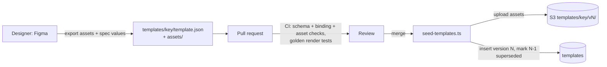

# 03 — Template Engine

Related: [01 Architecture](01-architecture.md) · [02 Data & API](02-data-and-api.md) · [04 Delivery & Operations](04-delivery-and-operations.md)

Templates are **data, not code**. A template is a JSON document: a fixed-size canvas, a background, and an ordered list of layers. Each layer has a frame, a style, and text or image sources with `{{bindings}}` into invitation data. One Flutter renderer turns `(spec, data)` into pixels for the preview, the PNG/PDF exports, and the published image.

```
Template = Canvas + Fonts + Background + Layers[ text | image | shape ]
                                         ▲ decorations are image/shape layers with role: "decoration"
Invitation data ──► BindingContext ──► Renderer ──► Widget tree ──► preview / PNG / JPEG / PDF
```

---

## 1. Design rules

1. **Fixed logical canvas** (e.g. 1080 × 1920). All coordinates are in canvas units, and the renderer scales the whole canvas uniformly. The same layout appears on a 360 dp phone, a tablet, the web, and a 1080 px export.
2. **Paint order = array order.** There is no `zIndex` field to keep in sync.
3. **Forward compatible.** Unknown layer types and unknown formatters are skipped, not fatal. A template that *needs* new renderer features sets `minRendererVersion`, and older apps never receive it ([02 §2.5](02-data-and-api.md#25-templates)).
4. **Immutable.** A published template version never changes ([D4](01-architecture.md#1-architecture-decisions-read-this-first)), so assets live under `templates/{key}/v{version}/` with year-long cache headers.
5. **No code in templates.** Bindings are paths plus a fixed formatter list. There are no expressions, scripts, or HTML, so a marketplace template can't execute anything.

---

## 2. Template specification

### 2.1 Example: `templates/birthday-balloons/template.json`

```json
{
  "schemaVersion": 1,
  "key": "birthday-balloons",
  "version": 1,
  "name": "Balloons",
  "eventTypes": ["birthday"],
  "tags": ["kids", "colorful"],
  "minRendererVersion": 1,
  "spec": {
    "canvas": { "width": 1080, "height": 1920 },
    "fonts": [
      { "family": "Pacifico", "weight": 400, "url": "https://cdn.domain.com/fonts/pacifico/Pacifico-Regular.ttf" },
      { "family": "Poppins",  "weight": 400, "url": "https://cdn.domain.com/fonts/poppins/Poppins-Regular.ttf" },
      { "family": "Poppins",  "weight": 600, "url": "https://cdn.domain.com/fonts/poppins/Poppins-SemiBold.ttf" }
    ],
    "background": {
      "color": "#FFF7EC",
      "image": { "src": "https://cdn.domain.com/templates/birthday-balloons/v1/bg.webp", "fit": "cover" }
    },
    "layers": [
      {
        "id": "balloons", "type": "image", "role": "decoration",
        "frame": { "x": 0, "y": 0, "w": 1080, "h": 520 },
        "src": "https://cdn.domain.com/templates/birthday-balloons/v1/balloons.webp", "fit": "contain"
      },
      {
        "id": "photo", "type": "image",
        "frame": { "x": 340, "y": 470, "w": 400, "h": 400 },
        "src": "{{media.photoUrl}}", "fit": "cover",
        "clip": { "shape": "circle" },
        "border": { "width": 14, "color": "#FFFFFF" },
        "visibleIf": "media.photoUrl"
      },
      {
        "id": "title", "type": "text",
        "frame": { "x": 80, "y": 920, "w": 920, "h": 260 },
        "text": "{{event.personName}} is turning {{event.age}}!",
        "visibleIf": "event.age",
        "style": {
          "fontFamily": "Pacifico", "fontSize": 104, "minFontSize": 56, "fontWeight": 400,
          "color": "#D6336C", "align": "center", "verticalAlign": "middle",
          "lineHeight": 1.15, "maxLines": 2,
          "shadow": { "color": "#33000000", "dx": 0, "dy": 6, "blur": 12 }
        }
      },
      {
        "id": "title-no-age", "type": "text",
        "frame": { "x": 80, "y": 920, "w": 920, "h": 260 },
        "text": "Join us to celebrate {{event.personName}}!",
        "visibleIf": "!event.age",
        "style": { "fontFamily": "Pacifico", "fontSize": 96, "minFontSize": 56, "color": "#D6336C",
                   "align": "center", "verticalAlign": "middle", "maxLines": 2 }
      },
      {
        "id": "card", "type": "shape", "role": "decoration",
        "frame": { "x": 90, "y": 1220, "w": 900, "h": 520 },
        "shape": "rect", "radius": 40, "fill": "#E6FFFFFF",
        "stroke": { "width": 3, "color": "#F3A0B5" }
      },
      {
        "id": "when", "type": "text",
        "frame": { "x": 130, "y": 1260, "w": 820, "h": 140 },
        "text": "{{details.date|date:EEEE, d MMMM}}\n{{details.time|time}}",
        "style": { "fontFamily": "Poppins", "fontSize": 52, "fontWeight": 600, "color": "#3B2F4A",
                   "align": "center", "lineHeight": 1.3, "maxLines": 2 }
      },
      {
        "id": "where", "type": "text",
        "frame": { "x": 130, "y": 1420, "w": 820, "h": 160 },
        "text": "{{details.venue.name}}\n{{details.venue.address}}",
        "style": { "fontFamily": "Poppins", "fontSize": 40, "minFontSize": 28, "color": "#5B4D6B",
                   "align": "center", "lineHeight": 1.3, "maxLines": 3 }
      },
      {
        "id": "rsvp", "type": "text",
        "frame": { "x": 130, "y": 1600, "w": 820, "h": 100 },
        "text": "RSVP {{details.rsvp.phone}} by {{details.rsvp.deadline|date:d MMM}}",
        "visibleIf": "details.rsvp.deadline",
        "style": { "fontFamily": "Poppins", "fontSize": 34, "color": "#8A7A99", "align": "center", "maxLines": 1 }
      }
    ]
  }
}
```

A binding takes **one** formatter. Write a fallback as its own binding, or use `visibleIf` to pick between alternative layers (see `title` / `title-no-age`). `default:` arguments are literal text, never paths.

### 2.2 Schema reference (v1)

**Root `spec`**

| Field | Type | Req | Notes |
|-------|------|-----|-------|
| `canvas.width/height` | int | ✓ | Logical units. Standard sizes: 1080×1920 (story), 1080×1350 (portrait), 1080×1080 (square) |
| `fonts[]` | `{family, weight, style?, url}` | ✓ | TTF/OTF on CDN. Families are namespaced at load time (§5.2) |
| `background.color` | color | | Painted first |
| `background.image` | `{src, fit}` | | `fit` ∈ `cover \| contain \| fill` |
| `layers[]` | Layer | ✓ | Paint order |

**Common layer fields**

| Field | Type | Default | Notes |
|-------|------|---------|-------|
| `id` | string | — | Unique within the template; used in golden-test names and future per-invitation overrides |
| `type` | `text \| image \| shape` | — | Unknown → skipped |
| `role` | `content \| decoration` | `content` | Decorations are hidden from screen readers |
| `frame` | `{x, y, w, h}` | — | Top-left origin, canvas units |
| `rotation` | number (deg) | 0 | Around frame centre |
| `opacity` | 0–1 | 1 | |
| `visibleIf` | path, or `!path` | always | Visible when the bound value is non-empty (null, `""`, `false` count as empty) |

**`text` layer**

| Field | Type | Default | Notes |
|-------|------|---------|-------|
| `text` | string with `{{…}}` | — | `\n` = line break |
| `style.fontFamily` | string | — | Must be declared in `fonts` |
| `style.fontSize` | number | — | Canvas units |
| `style.minFontSize` | number | = fontSize | If set, auto-shrink to fit the frame (§5.3) |
| `style.fontWeight` | 100–900 | 400 | |
| `style.italic` | bool | false | |
| `style.color` | color | `#000000` | |
| `style.align` | `left \| center \| right \| justify` | `left` | |
| `style.verticalAlign` | `top \| middle \| bottom` | `top` | |
| `style.lineHeight` | number | 1.2 | Multiplier |
| `style.letterSpacing` | number | 0 | Canvas units |
| `style.maxLines` | int | none | Ellipsis after |
| `style.transform` | `none \| uppercase \| lowercase` | `none` | |
| `style.shadow` | `{color, dx, dy, blur}` | none | |
| `style.stroke` | `{width, color}` | none | Outlined text |

**`image` layer**: `src` (URL or `{{binding}}`), `fit` (`cover|contain|fill`), `clip` (`{shape: rect|circle, radius?}`), `border` (`{width, color}`).

**`shape` layer**: `shape` (`rect|ellipse|line`), `fill` (color), `radius`, `stroke` (`{width, color, dash?: [on, off]}`).

**Colors** are `#RRGGBB` or `#AARRGGBB`. Gradients (`{"type":"linear","colors":[…],"angle":…}`) are **schema v2**, added when a design needs them.

### 2.3 Validation

The same rules run in two places:
- **CI** for `templates/**/template.json`: a JSON Schema in `templates/schema.v1.json`, checked with `ajv` in the seed script.
- **The Flutter parser**: Freezed `fromJson` with a `fallbackUnion`.

A template is rejected in CI if:
- a `fontFamily` is not declared,
- a binding path is unknown for its declared `eventTypes`,
- a frame lies outside the canvas,
- an asset is missing (asset paths are relative to `templates/`, e.g. `fonts/poppins/Poppins-Regular.ttf`, with `..` rejected; the API prefixes them with `ASSET_BASE_URL` when serving).

The schema uses Ajv's `discriminator` on the layer `type`, so a broken image layer reports image-layer errors.

---

## 3. Binding

### 3.1 Data context

The renderer never sees the `Invitation` model directly. It gets a flat, documented map built by `BindingContext.fromInvitation()`. This map **is the contract with template designers**:

| Path | Source | Example |
|------|--------|---------|
| `event.*` | `eventData` (minus `type`) | `event.personName`, `event.age` · P2: `event.brideName`, `event.groomName`, `event.motherName`, `event.fatherName` |
| `details.eventName`, `details.hostName`, `details.description`, `details.contactPhone` | `details` | |
| `details.venue.name/address` | `details.venue` | |
| `details.date`, `details.time`, `details.timezone` | wall-clock strings | `2026-12-05`, `16:30` |
| `details.rsvp.enabled/phone/deadline/note` | `details.rsvp` | |
| `media.photoUrl` | `media` | |

### 3.2 Grammar

```
binding   := "{{" path ( "|" formatter ( ":" arg )? )? "}}"
path      := segment ( "." segment )*        // [A-Za-z0-9_]+
```

| Formatter | Input | Output (`en`) |
|-----------|-------|---------------|
| `date:<intl pattern>` | `yyyy-MM-dd` | `date:EEEE, d MMMM` → `Saturday, 5 December` |
| `time` | `HH:mm` | `4:30 PM` (locale `jm`) |
| `upper` / `lower` | any | |
| `ordinal` | int | `5th` (*shortcut: English only; upgrade with a per-locale table when a non-English locale ships*) |
| `default:<literal>` | any | literal when the value is empty |

An unknown formatter returns the raw value and asserts in debug builds.

### 3.3 Binder (complete)

```dart
final _binding = RegExp(r'\{\{\s*([A-Za-z0-9_.]+)\s*(?:\|\s*(\w+)(?::([^}]*))?)?\s*\}\}');

class BindingContext {
  BindingContext(this._data, {this.locale = 'en_US'});
  final Map<String, Object?> _data;
  final String locale;

  Object? lookup(String path) {
    Object? node = _data;
    for (final key in path.split('.')) {
      if (node is! Map) return null;
      node = node[key];
    }
    return node;
  }

  bool isVisible(String? rule) {
    if (rule == null) return true;
    final negate = rule.startsWith('!');
    final v = lookup(negate ? rule.substring(1) : rule);
    final present = v != null && v != false && v.toString().isNotEmpty;
    return negate ? !present : present;
  }

  String bind(String template) => template.replaceAllMapped(_binding, (m) {
        final value = lookup(m[1]!);
        return _format(value, m[2], m[3]?.trim());
      });

  String _format(Object? v, String? formatter, String? arg) {
    final s = v?.toString() ?? '';
    switch (formatter) {
      case null: return s;
      case 'default': return s.isEmpty ? (arg ?? '') : s;
      case 'upper': return s.toUpperCase();
      case 'lower': return s.toLowerCase();
      case 'date':
        final d = DateTime.tryParse(s);
        return d == null ? s : DateFormat(arg ?? 'yMMMd', locale).format(d);
      case 'time':
        final p = s.split(':');
        if (p.length != 2) return s;
        return DateFormat.jm(locale).format(DateTime(2000, 1, 1, int.parse(p[0]), int.parse(p[1])));
      case 'ordinal':
        final n = int.tryParse(s);
        if (n == null) return s;
        final suffix = (n % 100 >= 11 && n % 100 <= 13) ? 'th' : const {1: 'st', 2: 'nd', 3: 'rd'}[n % 10] ?? 'th';
        return '$n$suffix';
      default:
        assert(false, 'Unknown formatter $formatter');
        return s;
    }
  }
}
```

`en_US` is the only locale `intl` ships without `initializeDateFormatting(locale)`; any other locale must be initialised at startup or `DateFormat` throws. The shipped binder (`app/lib/template_engine/binding/binding_context.dart`) also replaces U+202F (CLDR puts a narrow no-break space in `4:30 PM`) with a plain space, because template fonts often lack that glyph.

The binder is pure Dart. It has the most unit tests in the app: every formatter, missing paths, `11th/12th/13th`, and `!` negation.

---

## 4. Model (Flutter)

```dart
@freezed
abstract class TemplateSpec with _$TemplateSpec {
  const factory TemplateSpec({
    required CanvasSize canvas,
    @Default([]) List<FontSpec> fonts,
    BackgroundSpec? background,
    required List<Layer> layers,
  }) = _TemplateSpec;
  factory TemplateSpec.fromJson(Map<String, dynamic> json) => _$TemplateSpecFromJson(json);
}

@Freezed(unionKey: 'type', fallbackUnion: 'unknown')
sealed class Layer with _$Layer {
  const factory Layer.text({required String id, required Frame frame, required String text,
      required TextStyleSpec style, @Default(0) double rotation, @Default(1) double opacity,
      @Default(LayerRole.content) LayerRole role, String? visibleIf}) = TextLayer;
  const factory Layer.image({required String id, required Frame frame, required String src,
      @Default(BoxFitSpec.cover) BoxFitSpec fit, ClipSpec? clip, BorderSpec? border,
      @Default(0) double rotation, @Default(1) double opacity,
      @Default(LayerRole.content) LayerRole role, String? visibleIf}) = ImageLayer;
  const factory Layer.shape({required String id, required Frame frame, required ShapeKind shape,
      String? fill, @Default(0) double radius, StrokeSpec? stroke,
      @Default(0) double rotation, @Default(1) double opacity,
      @Default(LayerRole.content) LayerRole role, String? visibleIf}) = ShapeLayer;
  const factory Layer.unknown() = UnknownLayer;   // forward compatibility
  factory Layer.fromJson(Map<String, dynamic> json) => _$LayerFromJson(json);
}
```

Colors stay as strings in the model and are parsed once in the view (`parseColor('#AARRGGBB')`). This keeps the model JSON-symmetric.

---

## 5. Renderer

The shipped canvas also wraps the stack in `DefaultTextStyle(style: TextStyle())`, so no app theme (or the no-`Material` debug underline) leaks into template text; templates own every text property.

### 5.1 Canvas

```dart
class InvitationCanvas extends StatelessWidget {
  const InvitationCanvas({super.key, required this.spec, required this.data, this.boundaryKey});
  final TemplateSpec spec;
  final BindingContext data;
  final GlobalKey? boundaryKey; // set when exporting

  @override
  Widget build(BuildContext context) {
    final c = spec.canvas;
    return Semantics(
      label: _accessibleSummary(),           // full text for screen readers; layers below are excluded
      child: ExcludeSemantics(
        child: MediaQuery.withNoTextScaling(  // preview must equal export, regardless of OS text size
          child: AspectRatio(
            aspectRatio: c.width / c.height,
            child: FittedBox(
              child: RepaintBoundary(
                key: boundaryKey,
                child: SizedBox(
                  width: c.width.toDouble(),
                  height: c.height.toDouble(),
                  child: Stack(clipBehavior: Clip.hardEdge, children: [
                    if (spec.background case final bg?) Positioned.fill(child: BackgroundView(bg)),
                    for (final layer in spec.layers)
                      if (layer is! UnknownLayer && data.isVisible(layer.visibleIf))
                        Positioned(
                          left: layer.frame.x, top: layer.frame.y,
                          width: layer.frame.w, height: layer.frame.h,
                          child: Transform.rotate(
                            angle: layer.rotation * math.pi / 180,
                            child: Opacity(opacity: layer.opacity, child: LayerView(layer, data)),
                          ),
                        ),
                  ]),
                ),
              ),
            ),
          ),
        ),
      ),
    );
  }

  String _accessibleSummary() => spec.layers
      .whereType<TextLayer>()
      .where((l) => l.role == LayerRole.content && data.isVisible(l.visibleIf))
      .map((l) => data.bind(l.text))
      .join('. ');
}
```

`FittedBox` scales the fixed `SizedBox` to whatever space it has. The `RepaintBoundary` sits *inside* the scale, so `toImage(pixelRatio: 1)` always yields exactly `canvas.width × canvas.height` pixels, whatever the screen size.

### 5.2 Fonts

```dart
/// Loads template fonts at runtime from the CDN. Families are namespaced so a template's
/// "Poppins" never collides with the app theme's Poppins.
class FontRegistry {
  final _loaded = <String>{};
  final _http = Dio();

  String familyFor(String templateKey, String family) => 'tpl_${templateKey}_$family';

  Future<void> ensureLoaded(String templateKey, List<FontSpec> fonts) async {
    final byFamily = groupBy(fonts, (f) => f.family);
    await Future.wait(byFamily.entries.map((e) async {
      final name = familyFor(templateKey, e.key);
      if (!_loaded.add(name)) return;
      final loader = FontLoader(name);
      for (final f in e.value) {
        loader.addFont(_http
            .get<List<int>>(f.url, options: Options(responseType: ResponseType.bytes))
            .then((r) => ByteData.sublistView(Uint8List.fromList(r.data!))));
      }
      await loader.load();
    }));
  }
}
```

Multiple weights in one `FontLoader` family are matched by the engine using each font file's internal weight metadata. The CDN serves fonts with a year-long cache, so after the first load they come from the HTTP cache, and on mobile the Hive-cached spec avoids a refetch. `collection` provides `groupBy` and ships with Flutter.

### 5.3 Text layer with auto-fit

```dart
class TemplateText extends StatelessWidget {
  const TemplateText(this.layer, this.data, {super.key});
  final TextLayer layer;
  final BindingContext data;

  @override
  Widget build(BuildContext context) {
    final s = layer.style;
    var text = data.bind(layer.text);
    if (s.transform == TextTransformSpec.uppercase) text = text.toUpperCase();
    if (s.transform == TextTransformSpec.lowercase) text = text.toLowerCase();

    // TemplateScope is an InheritedWidget placed by InvitationCanvas; it knows the template key.
    final family = TemplateScope.of(context).fontFamily(s.fontFamily);
    final size = _fitFontSize(text, s, family, layer.frame);
    return Align(
      alignment: s.verticalAlign.toAlignment(s.align),
      child: Text(text,
        textAlign: s.align.toTextAlign(),
        maxLines: s.maxLines,
        overflow: s.maxLines == null ? TextOverflow.clip : TextOverflow.ellipsis,
        style: s.toTextStyle(fontSize: size, family: family),
      ),
    );
  }

  /// Largest size in [minFontSize, fontSize] whose layout fits the frame (binary search, ≤ 7 layouts).
  double _fitFontSize(String text, TextStyleSpec s, String family, Frame f) {
    final min = s.minFontSize ?? s.fontSize;
    if (min >= s.fontSize) return s.fontSize;
    bool fits(double size) {
      final tp = TextPainter(
        text: TextSpan(text: text, style: s.toTextStyle(fontSize: size, family: family)),
        textDirection: TextDirection.ltr, maxLines: s.maxLines,
      )..layout(maxWidth: f.w);
      final ok = !tp.didExceedMaxLines && tp.height <= f.h;
      tp.dispose();
      return ok;
    }
    if (fits(s.fontSize)) return s.fontSize;
    var lo = min, hi = s.fontSize;
    while (hi - lo > 1) {
      final mid = (lo + hi) / 2;
      if (fits(mid)) { lo = mid; } else { hi = mid; }
    }
    return lo;
  }
}
```

### 5.4 Image and shape layers

- **Image:** `Image.network(src, fit: …)`, wrapped in `ClipOval`/`ClipRRect` for `clip` and a `DecoratedBox` border. While loading, the layer shows a neutral fill, never a spinner, because a spinner would end up in exports. The error widget is an empty box, and the incident goes to a Sentry breadcrumb.
- **Shape:** `DecoratedBox(BoxDecoration(color, borderRadius, border, shape))` for rect/ellipse. A `CustomPaint` is used only for `line` and dashed strokes.

### 5.5 "Render ready" gate

Export and publish must not capture a half-loaded canvas. `renderReady(spec, data)` resolves when both of these are done:
1. `FontRegistry.ensureLoaded(...)`
2. `precacheImage(NetworkImage(url), context)` for the background plus every visible image layer's bound `src`.

The preview screen shows a skeleton until `renderReady` completes. The export and publish buttons stay disabled until then.

---

## 6. Export

```dart
class Exporter {
  /// Exact canvas pixels × pixelRatio. Call only after renderReady.
  static Future<Uint8List> png(GlobalKey boundaryKey, {double pixelRatio = 1}) async {
    final boundary = boundaryKey.currentContext!.findRenderObject()! as RenderRepaintBoundary;
    final image = await boundary.toImage(pixelRatio: pixelRatio);
    try {
      final bytes = await image.toByteData(format: ui.ImageByteFormat.png);
      return bytes!.buffer.asUint8List();
    } finally {
      image.dispose();
    }
  }

  /// Upload renditions for publish: page (1080w, q82) + og (600w, q75). Isolate on mobile.
  static Future<({Uint8List page, Uint8List og})> publishJpegs(Uint8List png) => compute(_encode, png);

  static ({Uint8List page, Uint8List og}) _encode(Uint8List png) {
    final src = img.decodePng(png)!;
    final page = src.width > 1080 ? img.copyResize(src, width: 1080) : src;
    final og = img.copyResize(src, width: 600);
    return (page: img.encodeJpg(page, quality: 82), og: img.encodeJpg(og, quality: 75));
  }

  /// Single-page PDF at the canvas aspect ratio (5 in wide), image full-bleed.
  static Future<Uint8List> pdf(Uint8List png, CanvasSize c) async {
    const widthPt = 5 * PdfPageFormat.inch;
    final doc = pw.Document()
      ..addPage(pw.Page(
        pageFormat: PdfPageFormat(widthPt, widthPt * c.height / c.width, marginAll: 0),
        build: (_) => pw.Image(pw.MemoryImage(png), fit: pw.BoxFit.fill),
      ));
    return doc.save();
  }
}
```

| Output | How | Size (1080×1920) |
|--------|-----|------------------|
| PNG download | `pixelRatio: 1` | 1–4 MB |
| PDF download | PNG at `pixelRatio: 2` (2160×3840, ≈ 430 dpi at 5 in) embedded | 3–8 MB |
| Published page image | JPEG 1080w q82 | ~200–400 KB |
| OG image | JPEG 600w q75 | ~60–120 KB (stays under WhatsApp's preview size limit) |

**Known limits (shortcuts):**
- **PDF is raster.** Text is not selectable or vector. Upgrade path: a second "PDF painter" driven by the same `TemplateSpec`, when print shops or a premium tier ask for vector output.
- **Web `compute` runs on the main thread** (no isolates on web). JPEG encoding of 1080×1920 takes ~300–800 ms there, so show a "Preparing…" state. Upgrade: a web worker or `OffscreenCanvas.convertToBlob` via JS interop if users notice.
- **Web export of network images needs CORS.** `cdn.domain.com` must send `Access-Control-Allow-Origin: https://app.domain.com` (CloudFront response-headers policy). Without it, `toImage` fails on web with a tainted-canvas error. This is a Sprint 2 exit criterion.

---

## 7. Authoring workflow (Phase 1–3)



- Templates are developed with the non-prod `/dev/template-playground` route: paste a `template.json` (relative asset paths resolve against `ASSET_BASE_URL`) and switch sample presets (`full` with photo, `long-name`, `minimal`).
- `npm run db:seed-templates` validates, then inserts each `key`+`version` once. Re-running is a no-op; changed content under an existing version is refused ("bump version"). *Shortcut: no S3 upload yet; assets are served from `templates/` by the local assets server until the CDN exists.*
- Every template ships with **golden tests** for each sample preset. A renderer change that shifts any template fails CI.

Phase 4 (designer marketplace) replaces "Figma → JSON by hand" with a **web template editor**. It is a Flutter Web route that reuses `InvitationCanvas` with draggable frames and writes the same JSON. The schema, renderer, and review pipeline don't change; only the authoring tool is new.

---

## 8. Testing

| Level | What | Tool |
|-------|------|------|
| Unit | Binder: every formatter, missing paths, negation, ordinals | `flutter_test` |
| Unit | Spec parsing: every layer type, unknown layer → `UnknownLayer`, bad colors | `flutter_test` |
| Golden | Every template × sample presets; fonts loaded from repo assets | `matchesGoldenFile`, tagged `golden`: CI runs them only on macOS (`flutter test --tags golden`), everything else with `--exclude-tags golden` |
| Widget | Auto-fit text never overflows its frame for 200-char inputs | `flutter_test` |
| Integration | Publish flow end-to-end against staging (render → upload → publish → fetch `/i/{slug}`) | `integration_test` |
