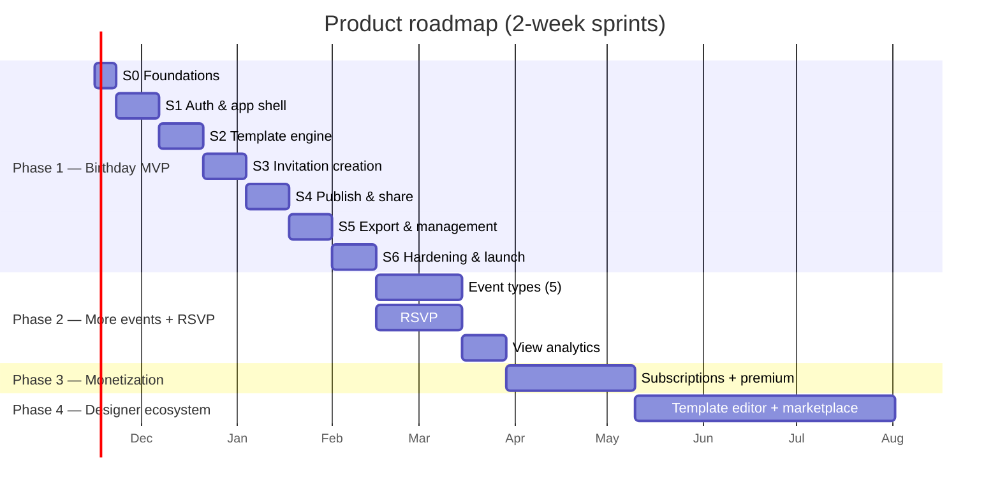
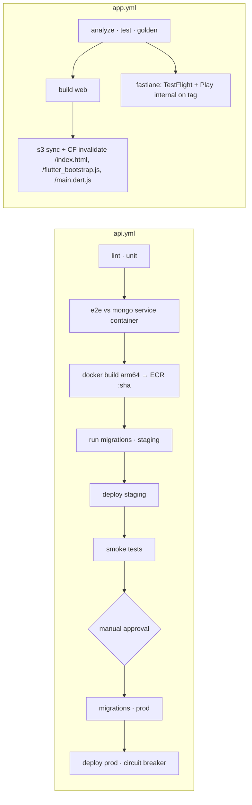

# 04 — Delivery, Deployment & Operations

Related: [01 Architecture](01-architecture.md) · [02 Data & API](02-data-and-api.md) · [03 Template Engine](03-template-engine.md)

---

## 1. Roadmap



| Phase | Scope | Exit criterion |
|-------|-------|----------------|
| **1. Birthday MVP** (~13 wks) | All 11 core features, Birthday only, 6–10 templates, iOS + Android + Web | Public launch; crash-free sessions ≥ 99.5%; publish → link works on WhatsApp |
| **2. Events + RSVP** | Wedding, Baby Shower, Engagement, Housewarming, Corporate (DTO + union variant + form + templates each). RSVP form on the public page, host RSVP list + CSV. View counts from CloudFront logs | 30% of published invites use RSVP |
| **3. Monetization** | Premium templates, custom slugs, no branding, multiple photos. **iOS/Android must use in-app purchase for digital goods** → RevenueCat across stores; Razorpay/Stripe on web. `subscriptions` collection fed by webhooks | Paying conversion measured; no store rejections |
| **4. Designer ecosystem** | Web template editor (reuses renderer), designer onboarding + KYC, submission → review → publish, `template_sales` ledger, monthly payouts, revenue share | First 20 external designers live |
| **5. B2B / multi-tenant** | Organizations, white-label domains (`invite.brand.com` → tenant), corporate event templates, team seats | First paying tenant |

---

## 2. Sprint plan: Phase 1

**Team assumption:** 2 Flutter, 1.5 backend, 1 designer, 0.5 DevOps, 0.5 QA, and 1 tech lead/PM. Fewer people means a longer timeline, not a smaller scope.

**Definition of Done for every story:** code reviewed, unit/widget tests, staging deploy via the pipeline, works on iOS + Android + Web, a11y labels present, no new Sentry errors.

| Sprint | Goal | Backend | Flutter | Design / DevOps | Exit criteria |
|--------|------|---------|---------|-----------------|---------------|
| **S0** (1 wk) Foundations | Everything deployable | Nest 11 scaffold, env validation, health, Dockerfile, docker-compose (Mongo 7) | Move app to `app/`, folder skeleton, flavors via `--dart-define-from-file`, Sentry | Terraform: VPC, ECR, ECS, ALB, S3×2, CloudFront×3, ACM, Route53, Secrets. Atlas project + peering. GitHub Actions. Template JSON schema v1 sign-off. 3 birthday designs | "hello" API on staging via pipeline; app builds for 3 platforms in CI |
| **S1** Auth & shell | Sign up, sign in, stay signed in | auth module, sessions, scrypt, global guard, error filter, request logging, throttling, `/users/me` GET/PATCH/DELETE, password change | Dio + AuthInterceptor, TokenStore (secure storage / web cookie), router + redirect, theme + tokens, login/register/profile, `AppFailure` mapping | WAF baseline rules | Register → login → refresh rotation → logout e2e on 3 platforms; replayed refresh token revokes session (test) |
| **S2** Template engine | Templates render identically everywhere | templates module, seed script, renderer-version filter, in-process cache | Spec models, binder (+tests), `InvitationCanvas`, text/image/shape views, FontRegistry, render-ready gate, gallery with Hive cache, `/dev/template-playground` | 3 templates in JSON; CDN CORS policy | Golden tests green for 3 templates × presets; web `toImage` works with CDN images |
| **S3** Creation | Create a draft with live preview | invitations CRUD, optimistic concurrency, cursor pagination, soft delete, media presigned POST | Event type → details form (birthday) with validation + Hive autosave → template picker → preview with edit panel, debounced save, photo picker + upload | 3 more templates | Draft created, photo added, edited on phone and resumed on web; conflict UX verified |
| **S4** Publish & share | A shareable link that previews well | publish/unpublish, slug, render-key checks, public JSON + HTML page, CloudFront invalidation, app-config | Publish flow (render → JPEG ×2 → upload → publish), share screen: share sheet, WhatsApp (`wa.me`), SMS, email, copy link | `invite` distribution: cache policy (path-only key), Origin Shield | WhatsApp/iMessage/Facebook show a rich preview; `/i/{slug}` < 1 s LCP on throttled 4G |
| **S5** Export & management | Complete feature set | account-deletion cascade, edit-published invalidation | PNG/PDF export (mobile share, web download), invitations list with filters + pagination, manage screen (edit, unpublish, delete), profile/avatar, empty/error states, force-update screen | Store listings, privacy policy, screenshots | All 11 core features pass the QA regression suite |
| **S6** Hardening & launch | Production-ready | k6 load test, index review (Atlas advisor), backup restore drill | Accessibility pass (TalkBack/VoiceOver/screen reader on web), performance profiling, offline behaviour | Alarms + dashboards, runbooks, OWASP ASVS L1 checklist, external pentest (light), TestFlight + Play closed testing → staged rollout | Launch checklist (§6) all green |

**Phase 2 outline (4 × 2-week sprints):**
- **P2-S1:** `rsvps` module + public RSVP form (rate-limited, honeypot).
- **P2-S2:** Host RSVP dashboard + CSV export, plus Wedding and Baby Shower types.
- **P2-S3:** Engagement, Housewarming, and Corporate types, plus the analytics pipeline (CloudFront logs → Athena → `analytics_daily`).
- **P2-S4:** Views on the invitation detail screen, Phase 2 polish.

---

## 3. Deployment architecture

### 3.1 Environments

| Env | API | Database | Web | Mobile |
|-----|-----|----------|-----|--------|
| local | `docker compose up` (api + mongo:7) | local container | `flutter run -d chrome` | simulators |
| staging | ECS, 1 task, **Fargate Spot** | Atlas Flex, synthetic data only | `staging.app.domain.com` | TestFlight / Play internal |
| prod | ECS, ≥2 tasks across 2 AZs | Atlas M10 (3-node), continuous backup | `app.domain.com` | App Store / Play (staged rollout) |

Region `ap-south-1` (Mumbai) is **assumed from an India-first audience**. It keeps latency low and suits DPDP data-residency expectations. Change the region if that assumption is wrong.

### 3.2 Network (cost-aware)

- ECS tasks run in **public subnets with public IPs**. Their security group only allows inbound traffic from the ALB security group. **No NAT gateway** saves about $35–70/month plus per-GB processing fees.
- Atlas is reached through **VPC peering** (routes via the peering connection, not the internet). S3 is reached through a **gateway VPC endpoint** (free).
- ECR, Secrets Manager, and CloudWatch are reached over the public internet with TLS and IAM auth. Add interface endpoints only if a compliance rule requires private-only egress, at about $7/month per endpoint per AZ.
- Staging's Atlas Flex uses an IP allow-list; it holds no real user data. *Shortcut: staging Atlas reachable from changing Fargate IPs requires `0.0.0.0/0` with strong unique credentials. Upgrade to peering (needs M10) once staging carries anything sensitive.*

### 3.3 Container

```dockerfile
# api/Dockerfile
FROM node:22-alpine AS build
WORKDIR /app
COPY package*.json ./
RUN npm ci
COPY . .
RUN npm run build && npm prune --omit=dev

FROM node:22-alpine
ENV NODE_ENV=production
WORKDIR /app
COPY --from=build /app/node_modules ./node_modules
COPY --from=build /app/dist ./dist
COPY --from=build /app/package.json ./
USER node
EXPOSE 3000
CMD ["node", "dist/main.js"]
```

Build for `linux/arm64` and run Fargate on **Graviton**, which is about 20% cheaper than x86 for the same vCPU/memory.

### 3.4 ECS service settings

- Task size 0.5 vCPU / 1 GB. Desired count 2, min 2, max 10. Target tracking at **CPU 60%**, plus ALB request count per target.
- **Deployment circuit breaker with rollback** enabled. Settings are min healthy 100% and max 200% (rolling, zero downtime).
- ALB health check `GET /health` (no DB) every 15 s. Deregistration delay is 30 s. The app handles `SIGTERM` via `enableShutdownHooks()`.
- Secrets (`MONGODB_URI`, `JWT_SECRET`, `SENTRY_DSN`) are injected from Secrets Manager via the task definition `secrets`. They are never baked into images.

### 3.5 CI/CD (GitHub Actions)



- Path filters: `api/**` triggers `api.yml`, and `app/**` + `templates/**` trigger `app.yml`. Template changes also run `seed-templates.ts --env staging`.
- AWS uses OIDC federation from GitHub to IAM roles, so there are **no long-lived AWS keys** in GitHub.
- Mobile signing keys live in GitHub encrypted secrets; fastlane `match` holds iOS certs. Android uses a Play App Signing upload key.
- Migrations are idempotent and backward compatible (expand → deploy → contract), so a rollback never needs a down-migration.

---

## 4. Production considerations

| Area | Decision |
|------|----------|
| **Availability** | ≥2 tasks in 2 AZs. Atlas 3-node replica set with automatic failover. CloudFront serves stale public pages (`stale-while-revalidate`, plus `stale-if-error=86400` on the origin response) during an origin outage, so **guests can keep viewing invitations while the API is down.** |
| **Backups** | Atlas continuous backup with point-in-time restore (7-day window) and daily snapshots kept 30 days. S3 media bucket versioning, with noncurrent versions expiring after 30 days. **Restore drill each quarter.** |
| **Mobile version skew** | `GET /v1/app-config` → force-update screen below `minSupportedVersion`. The API stays backward compatible for ≥ 2 released app versions. `X-Client-Renderer` keeps new templates from reaching old renderers. |
| **Observability** | CloudWatch alarms → SNS → Slack/email. ALB 5xx > 1% for 5 min; target p95 > 800 ms; ECS CPU > 80%; unhealthy hosts > 0; Atlas: replication lag, connections > 80%, disk > 70%. Sentry: new issue, regression, crash-free < 99.5%. |
| **Dashboards** | One CloudWatch dashboard: requests, 5xx, p50/p95 latency, ECS CPU/mem, CloudFront hit ratio for `invite`, publish success rate (log metric filter). |
| **Runbooks** | Under `docs/runbooks/`: API 5xx spike, Atlas failover, rollback a deploy (re-deploy previous task definition), takedown request (unpublish + invalidate), leaked secret rotation. |
| **Content moderation** | Public pages carry user content. A "Report this invitation" link on the page goes to an admin takedown endpoint (`POST /v1/admin/invitations/:id/takedown`, role admin). Terms of Service forbid abuse. |
| **Legal / store** | Privacy policy and terms. In-app **account deletion** (Apple 5.1.1(v), Google Play policy). Data-safety form (Play), privacy nutrition label (iOS). DPDP Act (India) consent text at signup. |
| **Email** | Phase 1 has no email sending, which also means no verification and no password reset by email. *Shortcut: password reset is an important gap; add Amazon SES + reset tokens in S5 if time allows, otherwise first thing post-launch.* |

---

## 5. Security considerations

| Threat | Control |
|--------|---------|
| Credential stuffing / brute force | WAF rate-based rule on `/v1/auth/*` (per IP), `@nestjs/throttler` per task, generic login errors, constant-time verify |
| Weak password storage | scrypt (N=2¹⁴, r=8, p=5) with per-user salt; parameters stored with the hash for future upgrades |
| Token theft | 15-min access JWT; refresh rotation with replay detection; mobile tokens in Keychain/Keystore; web refresh token `httpOnly` cookie, access token in memory only |
| Broken object-level authz (IDOR) | Ownership in every query (`ownerId: user.sub`); 404 for non-owned; e2e tests that user B cannot read/update/delete/publish user A's invitation |
| NoSQL injection | `ValidationPipe` whitelist + typed DTOs (operators can't pass as strings) + Mongoose `sanitizeFilter` |
| XSS on public page | All values HTML-escaped; strict CSP (`default-src 'none'`); no user-supplied HTML; `mapUrl` restricted to `https://` and validated |
| Malicious uploads | Server-chosen keys, presigned POST with content-type + size limits, private bucket behind OAC, served from a separate `cdn.` domain (cookie isolation), images only |
| Slug enumeration | 10-char random slug (36¹⁰ ≈ 3.7 × 10¹⁵); no sequential ids in public URLs; `X-Robots-Tag: noindex` on invitation pages (private events shouldn't be in search engines) |
| PII exposure | Public projection allow-list; UI warns that contact phone is shown publicly; logs exclude bodies/phones/emails |
| Secrets | Secrets Manager; GitHub OIDC; rotation runbook; `gitleaks` in CI |
| Dependencies / supply chain | Dependabot (npm, pub, Actions, Docker), `npm audit --omit=dev` gating on high, pinned base image digests |
| Transport | TLS 1.2+ everywhere (ACM), HSTS via helmet, HTTP → HTTPS redirect at CloudFront/ALB |
| Abuse of public endpoints | WAF managed rules (Core, Known Bad Inputs, IP reputation), rate limits on `/i/*` origin requests |
| Template injection (Phase 4 marketplace) | Templates are pure data: fixed formatter list, no expressions; asset URLs must be on `cdn.domain.com`; human review before publish |

Before launch, run the OWASP ASVS Level 1 checklist and a light external pentest (S6).

---

## 6. Scalability considerations

**Back-of-envelope at target scale:** 100k users, 500k invitations, 5M public views/month (~2 req/s average, 200 req/s viral peak).

| Path | Load at target | Why it holds | Next lever |
|------|---------------|--------------|-----------|
| Public page `/i/*` | 5M/mo at edge | CloudFront hit ratio > 95% (path-only cache key, 5 min TTL, Origin Shield collapses misses), so origin sees < 10 req/s | Raise `s-maxage` (invalidations already handle freshness) |
| Invitation images | 5M × ~300 KB ≈ 1.5 TB/mo | Immutable on CDN, JPEG not PNG | WebP/AVIF variants |
| Authenticated API | ~20 req/s peak | 2 small Fargate tasks handle ~200 req/s | Autoscaling (already configured) |
| MongoDB | 4 GB, low write rate | All hot queries index-backed, no `$lookup` | M20/M30 vertical scaling |
| Template reads | every editor open | Immutable → in-process LRU on the server, Hive on the client | — |
| RSVP (P2) | bursts after sharing | Single-document inserts, indexed by `invitationId` | Separate cluster / hashed shard key |
| Analytics (P2) | per view | Never on the request path; batch from CDN logs | Kinesis Firehose if near-real-time is needed |

**Load-test gate (S6, k6):**
- 500 req/s for 10 min against `/i/{slug}` with cache bypassed on 10% of requests, plus 50 req/s of authenticated mix.
- Pass criteria: origin p95 < 150 ms, error rate < 0.1%, autoscaling observed.

---

## 7. Cost

### 7.1 Monthly estimate: production at launch (ap-south-1)

These are planning numbers from public list prices. Verify in the AWS Pricing Calculator and Atlas pricing before you budget.

| Item | Config | ~USD/month |
|------|--------|-----------|
| ECS Fargate (Graviton) | 2 × 0.5 vCPU / 1 GB, 24×7 | 25–30 |
| ALB | 1 ALB, low LCU | 18–25 |
| MongoDB Atlas | M10, 3-node, backup | 60–80 |
| CloudFront | 3 distributions; first 1 TB + 10M requests/month free (always-free tier) | 0–40 |
| S3 | < 100 GB + requests | 3–5 |
| WAF | 1 web ACL + ~5 rules + requests | 10–15 |
| Secrets Manager, Route53, CloudWatch Logs (30-day retention) | | 10–15 |
| Sentry | Team plan | 26 |
| **Total** | | **≈ $150–240** |

Staging adds about $25–40 (Fargate Spot, Atlas Flex, shared CloudFront). Apple Developer is $99/year, and Google Play is a one-time $25.

### 7.2 Optimization recommendations

1. **No NAT gateway** (§3.2). This is the single biggest avoidable fixed cost in small AWS setups.
2. **Graviton + Compute Savings Plan** (1-year, no upfront) once usage is stable for about 3 months: roughly 20% plus ~20–30% off Fargate.
3. **JPEG for public images, not PNG.** That is 5–10× less CDN egress, which is the cost that scales with virality.
4. **Content-addressed render keys** mean no paid CloudFront invalidations for images. Only `/i/{slug}` is invalidated, and the first 1,000 paths per month are free.
5. **Path-only cache key** on `invite.` (strip `utm_*` and cookies) keeps hit ratio high, so origin compute stays flat as views grow.
6. **CloudWatch log retention of 30 days** (default is forever), and no request-body logging.
7. **S3 lifecycle rules:** expire noncurrent versions after 30 days, delete abandoned draft uploads (`users/*/photos/*` not referenced; tag on attach, lifecycle-delete untagged objects after 7 days), and abort incomplete multipart uploads.
8. **Fargate Spot for staging**, scaled to 0 tasks at night via a scheduled action.
9. **Right-size Atlas from metrics, not guesses.** Stay on M10 until the Performance Advisor and CPU say otherwise.
10. **No Redis, Kubernetes, or microservices** until a measured need appears ([D1, D6](01-architecture.md#1-architecture-decisions-read-this-first)). Each one adds fixed monthly cost plus ops time.

---

## 8. Launch checklist (S6 exit)

- [ ] All 11 core features pass the QA regression suite on iOS, Android, Chrome, Safari
- [ ] Golden tests green; renderer version = 1 recorded in app and API
- [ ] k6 gate passed (§6)
- [ ] Alarms fire to Slack (tested by forcing a 5xx)
- [ ] Atlas restore drill completed; RPO/RTO documented
- [ ] Rollback rehearsed (previous task definition redeployed)
- [ ] OWASP ASVS L1 checklist complete; pentest findings ≥ medium fixed
- [ ] IDOR e2e tests pass
- [ ] WhatsApp, iMessage, Facebook, X link previews verified for 3 templates
- [ ] Account deletion verified end-to-end (DB + S3 + public link 404)
- [ ] Privacy policy, terms, store listings, data-safety forms submitted
- [ ] Staged rollout plan: 10% → 50% → 100% over 7 days, with a halt rule (crash-free < 99.5%)
